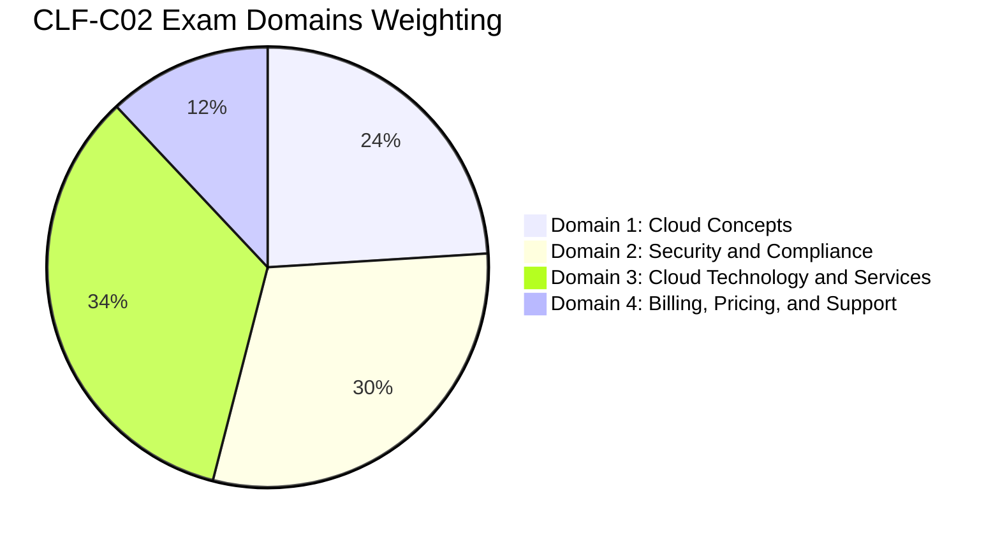
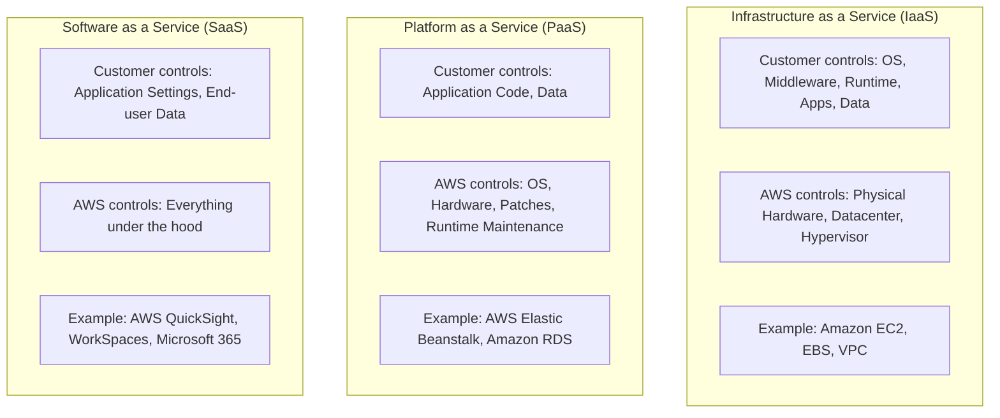
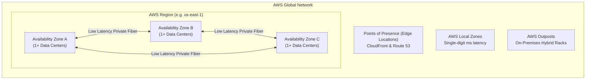
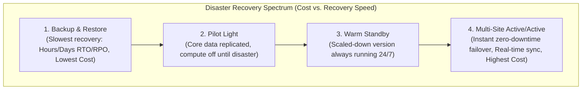
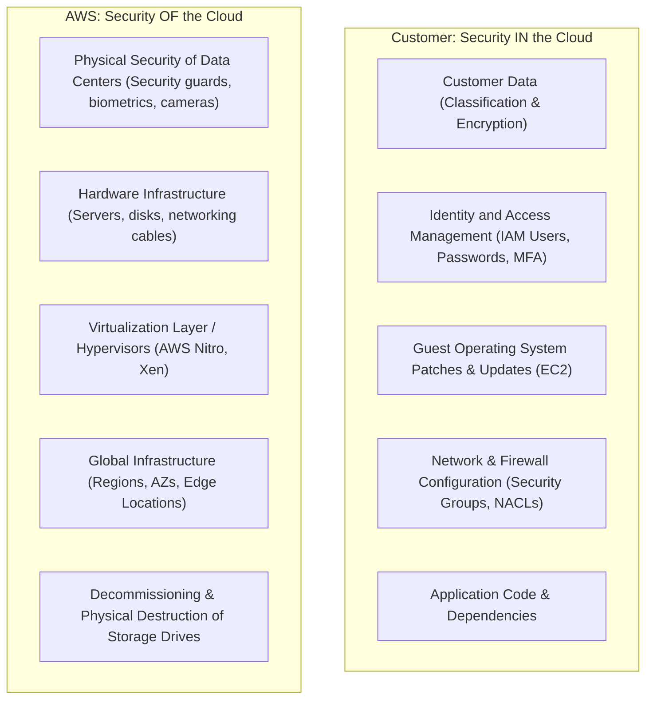
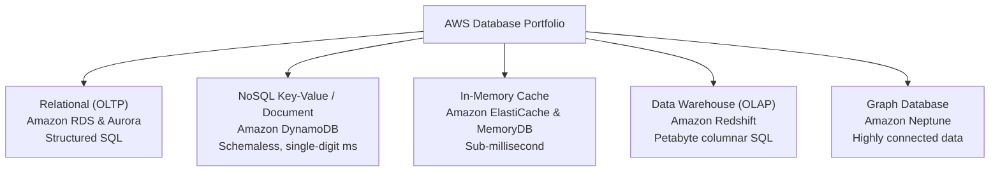
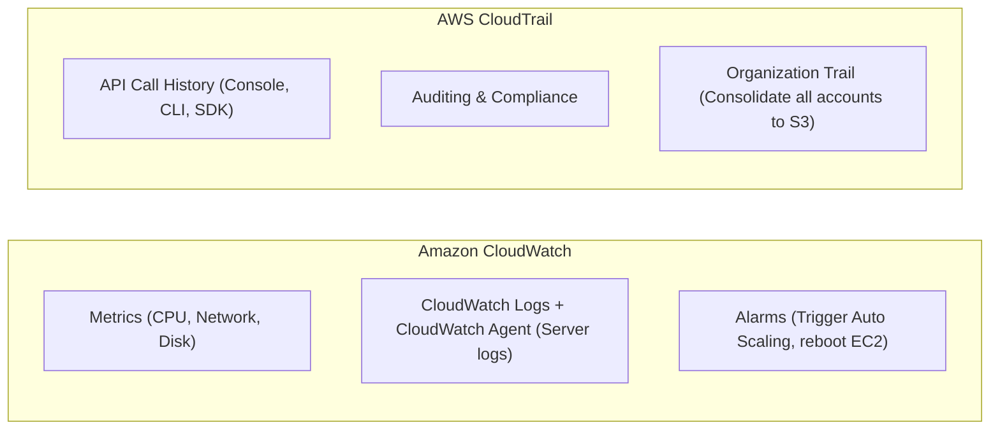

# ☁️ AWS Certified Cloud Practitioner (CLF-C02) Complete Study Guide & Exam Notes

[](https://aws.amazon.com/certification/certified-cloud-practitioner/)
[](https://aws.amazon.com/certification/certified-cloud-practitioner/)
[](LICENSE)
[](https://github.com/)

A comprehensive, structured, and exam-focused revision guide for the **AWS Certified Cloud Practitioner (CLF-C02)** exam. This repository covers all exam domains, core concepts, AWS services, architectural principles, security models, billing mechanisms, **real exam question patterns, distractor trap analysis**, and high-yield comparison cheat sheets with direct video lecture timestamps from the renowned [freeCodeCamp 13+ Hour Full Course](https://www.youtube.com/watch?v=7HKot-brXFE).

---

## 🎯 Exam Overview & Blueprint

| Feature | Details |
| :--- | :--- |
| **Exam Code** | **CLF-C02** (Current Version) |
| **Duration** | 90 minutes (~1.3 minutes per question) |
| **Number of Questions** | 65 questions (Multiple choice or multiple response) |
| **Scoring Scale** | 100 – 1,000 |
| **Passing Score** | **700 / 1000** (~70%) |
| **Prerequisites** | None. Designed for candidates from technical and non-technical backgrounds |
| **Unscored Questions** | 15 unscored evaluation questions randomly distributed (50 scored questions) |

### Domain Weightings



---

## 🧠 Decoding the CLF-C02 Exam: Question Patterns & Trap Guide

> [!IMPORTANT]
> The AWS Certified Cloud Practitioner exam does not just test basic memorization — it tests **scenario pattern recognition** and deliberately includes tempting distractor choices. Understanding how questions are constructed is the key to passing with a high score.

### The 10 Most Common Exam Question Patterns

| Pattern # | Question Pattern Type | Example Exam Wording | How to Identify the Correct Answer | Typical Distractor / Trap |
| :---: | :--- | :--- | :--- | :--- |
| **1** | **Off-the-Shelf vs. Roll-Your-Own** | *"Which service provides a ready-made list of under-utilized EC2 instances without manual configuration?"* | Pick managed tools that provide automated recommendations out-of-the-box (**AWS Trusted Advisor**, **AWS Compute Optimizer**, or **Cost Explorer Rightsizing**). | **Amazon CloudWatch** (TRAP: CloudWatch only collects raw metrics; you must build alarms and dashboards yourself!). |
| **2** | **Reversed Wording Traps** | *"Which of the following is an advantage of the AWS Cloud?"* | Look for exact wording: **Trade Capital Expense for Variable Expense** (CapEx ➔ OpEx). | Distractors say *"Trade operational expense for capital expense"* or *"Trade variable expense for fixed expense"*. |
| **3** | **One-Word Responsibility Traps** | *"Under the Shared Responsibility Model, which is an AWS responsibility?"* | AWS is responsible for security **OF** the cloud. Customer is responsible for security **IN** the cloud. | Distractors say *"AWS is responsible for security IN the cloud"* or *"AWS is responsible for customer IAM policies"*. |
| **4** | **Timeline: Plan vs. Forecast vs. Alert** | *"A company wants to forecast future costs based on historical spending..."* vs. *"estimate costs before deploying..."* | - Forecast past spend ➔ **AWS Cost Explorer**<br/>- Estimate before building ➔ **AWS Pricing Calculator**<br/>- Set threshold alerts ➔ **AWS Budgets** | Mixing up Cost Explorer (historical + forecast) with Pricing Calculator (pre-launch modeling). |
| **5** | **App Code vs. Infrastructure** | *"Which service automates deploying application code to EC2 instances and on-premises servers?"* | - Application code deployment ➔ **AWS CodeDeploy**<br/>- Infrastructure provisioning ➔ **AWS CloudFormation**<br/>- Pipeline workflow ➔ **AWS CodePipeline** | Picking CloudFormation for application code rollout, or picking CodePipeline when only deployment is asked. |
| **6** | **APN Partner Paths** | *"A company needs an expert firm to design, migrate, and manage workloads on AWS..."* | - People/services to migrate & manage ➔ **Services Path (Consulting Partner)**<br/>- Commercial software/SaaS products ➔ **Software Path (Technology Partner)** | Picking Technology Partner for consulting services, or picking AWS Concierge (which is just enterprise billing support). |
| **7** | **Public vs. Personalized Health** | *"Which dashboard provides an RSS feed of all AWS service interruptions without logging in?"* | - Public status of all services in all regions ➔ **AWS Health Dashboard - Service Health**<br/>- Specific events affecting *your* active resources ➔ **AWS Health Dashboard - Your Account Health** | Picking "Your Account Health" for public RSS feeds, or picking Service Health when account-specific impact is asked. |
| **8** | **Default Encryption Nuances** | *"Which services have data encryption automatically enabled by default without user configuration?"* | - **Amazon S3** (SSE-S3 default on all new objects since Jan 2023)<br/>- **Amazon DynamoDB** (encrypted at rest by default)<br/>- **AWS Storage Gateway** (encrypted in-transit & at-rest) | Assuming Amazon EBS is encrypted by default (EBS is opt-in per volume unless the regional account setting is enabled!). |
| **9** | **Multi-Account & Multi-Region IaC** | *"Which feature provisions the same infrastructure across 40 accounts and 3 regions from one template?"* | **AWS CloudFormation StackSets** | Picking AWS Systems Manager (SSM manages OS nodes/patching, it does NOT provision infrastructure). |
| **10** | **Server Logs vs. Account API Logs** | *"Which service centralizes application and server logs from both EC2 and on-premises servers?"* | **Amazon CloudWatch Logs with the CloudWatch Agent** | Picking **AWS CloudTrail** (TRAP: CloudTrail records *AWS API calls*, not OS or application logs!). |

---

## 📑 Table of Contents

- [☁️ AWS Certified Cloud Practitioner (CLF-C02) Complete Study Guide & Exam Notes](#️-aws-certified-cloud-practitioner-clf-c02-complete-study-guide--exam-notes)
  - [🎯 Exam Overview & Blueprint](#-exam-overview--blueprint)
  - [🧠 Decoding the CLF-C02 Exam: Question Patterns & Trap Guide](#-decoding-the-clf-c02-exam-question-patterns--trap-guide)
  - [📑 Table of Contents](#-table-of-contents)
  - [1. 🚀 Introduction & Cloud Fundamentals](#1--introduction--cloud-fundamentals)
    - [1.1 Course Orientation & Exam Guide](#11-course-orientation--exam-guide)
    - [1.2 What is Cloud Computing?](#12-what-is-cloud-computing)
    - [1.3 The 6 Advantages of Cloud Computing](#13-the-6-advantages-of-cloud-computing)
    - [1.4 Types of Cloud Computing (Cloud Service Models)](#14-types-of-cloud-computing-cloud-service-models)
    - [1.5 Cloud Deployment Models](#15-cloud-deployment-models)
    - [1.6 Evolution of Hosting & Digital Transformation](#16-evolution-of-hosting--digital-transformation)
    - [1.7 AWS Cloud Adoption Framework (AWS CAF)](#17-aws-cloud-adoption-framework-aws-caf)
    - [1.8 Cloud Migration Strategies: The 7 Rs & Migration Tools](#18-cloud-migration-strategies-the-7-rs--migration-tools)
  - [2. 🛡️ Getting Started & Account Security Baseline](#2-️-getting-started--account-security-baseline)
    - [2.1 AWS Account Creation & Root User Rules](#21-aws-account-creation--root-user-rules)
    - [2.2 AWS Free Tier Types](#22-aws-free-tier-types)
    - [2.3 Budgets & Zero-Spend Billing Alarms](#23-budgets--zero-spend-billing-alarms)
  - [3. 🌐 AWS Global Infrastructure](#3--aws-global-infrastructure)
    - [3.1 AWS Regions & Availability Zones (AZs)](#31-aws-regions--availability-zones-azs)
    - [3.2 Edge Locations & Points of Presence (PoP)](#32-edge-locations--points-of-presence-pop)
    - [3.3 Edge & Hybrid Infrastructure Solutions](#33-edge--hybrid-infrastructure-solutions)
    - [3.4 Regional vs. Global AWS Services](#34-regional-vs-global-aws-services)
    - [3.5 Specialized AWS Regions & Sovereignty](#35-specialized-aws-regions--sovereignty)
  - [4. 📐 Cloud Architecture & Reliability](#4--cloud-architecture--reliability)
    - [4.1 Core Architecture Terminologies](#41-core-architecture-terminologies)
    - [4.2 Disaster Recovery (DR) Strategies & RTO / RPO](#42-disaster-recovery-dr-strategies--rto--rpo)
    - [4.3 High Availability Architecture Design](#43-high-availability-architecture-design)
  - [5. 🧰 Management, Governance & Developer Tools](#5--management-governance--developer-tools)
    - [5.1 Ways to Interact with AWS (Console, CLI, SDK, CloudShell)](#51-ways-to-interact-with-aws-console-cli-sdk-cloudshell)
    - [5.2 Amazon Resource Names (ARN)](#52-amazon-resource-names-arn)
    - [5.3 Infrastructure as Code (IaC): CloudFormation & StackSets & CDK](#53-infrastructure-as-code-iac-cloudformation--stacksets--cdk)
    - [5.4 Developer Tools & Access Credentials](#54-developer-tools--access-credentials)
    - [5.5 AWS Systems Manager (SSM)](#55-aws-systems-manager-ssm)
  - [6. 🤝 AWS Shared Responsibility Model](#6--aws-shared-responsibility-model)
    - [6.1 The Core Model: "OF" vs. "IN" the Cloud](#61-the-core-model-of-vs-in-the-cloud)
    - [6.2 Shared Responsibility Across Service Models](#62-shared-responsibility-across-service-models)
    - [6.3 Shared Controls Matrix](#63-shared-controls-matrix)
  - [7. 💻 Compute Services](#7--compute-services)
    - [7.1 Amazon Elastic Compute Cloud (EC2) Overview & Families](#71-amazon-elastic-compute-cloud-ec2-overview--families)
    - [7.2 EC2 Tenancy: Shared vs. Dedicated Instances vs. Dedicated Hosts](#72-ec2-tenancy-shared-vs-dedicated-instances-vs-dedicated-hosts)
    - [7.3 EC2 Pricing Models Matrix & Rules](#73-ec2-pricing-models-matrix--rules)
    - [7.4 Scaling & Load Balancing: ASG, ALB, NLB, GWLB](#74-scaling--load-balancing-asg-alb-nlb-gwlb)
    - [7.5 Containers on AWS: ECS, EKS, Fargate, ECR](#75-containers-on-aws-ecs-eks-fargate-ecr)
    - [7.6 Serverless Compute: AWS Lambda](#76-serverless-compute-aws-lambda)
    - [7.7 Lightsail, Batch, App Runner & HPC](#77-lightsail-batch-app-runner--hpc)
  - [8. 🗄️ Storage Services](#8-️-storage-services)
    - [8.1 Storage Types Comparison (Block vs. File vs. Object)](#81-storage-types-comparison-block-vs-file-vs-object)
    - [8.2 Amazon S3 Storage Classes & Lifecycle Management](#82-amazon-s3-storage-classes--lifecycle-management)
    - [8.3 Amazon EBS vs. EC2 Instance Store](#83-amazon-ebs-vs-ec2-instance-store)
    - [8.4 Amazon EFS vs. Amazon FSx](#84-amazon-efs-vs-amazon-fsx)
    - [8.5 AWS Snow Family & Hybrid Storage Gateway](#85-aws-snow-family--hybrid-storage-gateway)
  - [9. 📊 Database & Analytics Services](#9--database--analytics-services)
    - [9.1 Database Types: Relational vs. NoSQL vs. In-Memory vs. Warehouse](#91-database-types-relational-vs-nosql-vs-in-memory-vs-warehouse)
    - [9.2 Relational: Amazon RDS & Amazon Aurora (Multi-AZ vs. Read Replicas)](#92-relational-amazon-rds--amazon-aurora-multi-az-vs-read-replicas)
    - [9.3 NoSQL: Amazon DynamoDB (Schemaless, Global Tables, DAX)](#93-nosql-amazon-dynamodb-schemaless-global-tables-dax)
    - [9.4 In-Memory Caching: Amazon ElastiCache & MemoryDB](#94-in-memory-caching-amazon-elasticache--memorydb)
    - [9.5 Analytics & Big Data: Redshift, Athena, Glue, EMR, QuickSight](#95-analytics--big-data-redshift-athena-glue-emr-quicksight)
  - [10. 🔌 Networking & Content Delivery](#10--networking--content-delivery)
    - [10.1 Amazon Virtual Private Cloud (VPC), Subnets & Gateways](#101-amazon-virtual-private-cloud-vpc-subnets--gateways)
    - [10.2 Security Groups vs. Network ACLs (NACLs)](#102-security-groups-vs-network-acls-nacls)
    - [10.3 Hybrid Connectivity: Direct Connect, VPN & Transit Gateway](#103-hybrid-connectivity-direct-connect-vpn--transit-gateway)
    - [10.4 VPC Endpoints (Gateway vs. Interface / PrivateLink)](#104-vpc-endpoints-gateway-vs-interface--privatelink)
    - [10.5 Content Delivery & DNS: CloudFront & Route 53](#105-content-delivery--dns-cloudfront--route-53)
  - [11. 🔐 Security, Identity & Compliance](#11--security-identity--compliance)
    - [11.1 AWS Identity and Access Management (IAM) Entities & PoLP](#111-aws-identity-and-access-management-iam-entities--polp)
    - [11.2 AWS IAM Identity Center, Cognito & Directory Service](#112-aws-iam-identity-center-cognito--directory-service)
    - [11.3 Encryption & Secrets Management: KMS, CloudHSM, Secrets Manager, Parameter Store](#113-encryption--secrets-management-kms-cloudhsm-secrets-manager-parameter-store)
    - [11.4 Threat Detection & Boundary Security (Shield, WAF, GuardDuty, Inspector)](#114-threat-detection--boundary-security-shield-waf-guardduty-inspector)
    - [11.5 Governance & Compliance: AWS Artifact, Audit Manager, Macie, Security Hub](#115-governance--compliance-aws-artifact-audit-manager-macie-security-hub)
  - [12. 🔄 Application Integration & Messaging](#12--application-integration--messaging)
    - [12.1 SQS vs. SNS vs. EventBridge vs. Kinesis](#121-sqs-vs-sns-vs-eventbridge-vs-kinesis)
    - [12.2 Orchestration & CI/CD: Step Functions, API Gateway, CodeDeploy, CodePipeline](#122-orchestration--cicd-step-functions-api-gateway-codedeploy-codepipeline)
  - [13. 📋 Cloud Governance, Management & Monitoring](#13--cloud-governance-management--monitoring)
    - [13.1 AWS Organizations & Service Control Policies (SCPs)](#131-aws-organizations--service-control-policies-scps)
    - [13.2 AWS Config vs. AWS Control Tower](#132-aws-config-vs-aws-control-tower)
    - [13.3 Observability: Amazon CloudWatch vs. AWS CloudTrail](#133-observability-amazon-cloudwatch-vs-aws-cloudtrail)
  - [14. 🤖 Machine Learning, AI & High-Performance Compute](#14--machine-learning-ai--high-performance-compute)
    - [14.1 Generative AI & Turnkey AI Services (Bedrock, SageMaker, Q, etc.)](#141-generative-ai--turnkey-ai-services-bedrock-sagemaker-q-etc)
    - [14.2 Custom AI Silicon: Trainium, Inferentia, Graviton](#142-custom-ai-silicon-trainium-inferentia-graviton)
  - [15. 🏛️ AWS Well-Architected Framework](#15-️-aws-well-architected-framework)
    - [15.1 The 6 Pillars & Their Core Design Principles](#151-the-6-pillars--their-core-design-principles)
    - [15.2 AWS Well-Architected Tool](#152-aws-well-architected-tool)
  - [16. 💰 Billing, Pricing & Support Plans](#16--billing-pricing--support-plans)
    - [16.1 Cloud Economics: CapEx vs. OpEx & What is FREE in AWS](#161-cloud-economics-capex-vs-opex--what-is-free-in-aws)
    - [16.2 Cost Tools: Pricing Calculator vs. Cost Explorer vs. Budgets vs. CUR](#162-cost-tools-pricing-calculator-vs-cost-explorer-vs-budgets-vs-cur)
    - [16.3 AWS Support Plans Comparison (Detailed Matrix)](#163-aws-support-plans-comparison-detailed-matrix)
    - [16.4 AWS Trusted Advisor & Health Dashboard](#164-aws-trusted-advisor--health-dashboard)
    - [16.5 Partner Network (APN), Marketplace & Startup Programs](#165-partner-network-apn-marketplace--startup-programs)
  - [17. 🆚 High-Yield Exam "Cheat Sheet" & Service Disambiguation](#17--high-yield-exam-cheat-sheet--service-disambiguation)
    - [17.1 Commonly Confused Services Cheat Sheet](#171-commonly-confused-services-cheat-sheet)
    - [17.2 Essential Acronyms & Initialisms Reference](#172-essential-acronyms--initialisms-reference)
  - [18. 🎓 Exam Strategy & Last-Minute Checklist](#18--exam-strategy--last-minute-checklist)

---

## 1. 🚀 Introduction & Cloud Fundamentals

### 1.1 Course Orientation & Exam Guide
- 🎥 **Video Sections**:
  - [1:07 - Introduction](https://www.youtube.com/watch?v=7HKot-brXFE&t=67s)
  - [1:07 - Is Certified Cloud Practitioner right for me?](https://www.youtube.com/watch?v=7HKot-brXFE&t=67s)
  - [6:10 - Exam Guide - Content Outline](https://www.youtube.com/watch?v=7HKot-brXFE&t=370s)

---

### 1.2 What is Cloud Computing?
- 🎥 **Video Sections**:
  - [8:51 - What is Cloud Computing?](https://www.youtube.com/watch?v=7HKot-brXFE&t=531s)
  - [14:03 - What is AWS?](https://www.youtube.com/watch?v=7HKot-brXFE&t=843s)
  - [29:47 - AWS Technology Overview](https://www.youtube.com/watch?v=7HKot-brXFE&t=1787s)

> [!NOTE]
> **NIST Cloud Computing Definition**: The **on-demand delivery of IT resources** (compute, storage, databases, networking, software) over the internet with **pay-as-you-go pricing**.

#### Key Characteristics:
1. **On-Demand Self-Service**: Provision resources automatically without human interaction with AWS.
2. **Broad Network Access**: Services accessible over the network from anywhere via browser, CLI, or API.
3. **Resource Pooling**: Multi-tenant infrastructure pooled to serve many customers securely.
4. **Rapid Elasticity**: Resources scale outward and inward dynamically to match demand.
5. **Measured Service**: Pay strictly for what is consumed with transparent monitoring.

---

### 1.3 The 6 Advantages of Cloud Computing
- 🎥 **Video Sections**:
  - [1:23:23 - The Benefits of the Cloud](https://www.youtube.com/watch?v=7HKot-brXFE&t=5003s)
  - [1:25:16 - The Seven Advantages of the Cloud](https://www.youtube.com/watch?v=7HKot-brXFE&t=5116s)

> [!IMPORTANT]
> **Must-Know Exam Trap**: Exam questions frequently reverse terms or swap single words!

| Advantage | Concept | Business Benefit | ⚠️ Exam Trap to Watch Out For |
| :--- | :--- | :--- | :--- |
| **1. Trade Capital Expense for Variable Expense** | Replace upfront hardware investment (**CapEx**) with pay-as-you-go operating expenses (**OpEx**). | Pay only for what you consume; zero upfront hardware depreciation. | **Trap**: Distractors say *"Trade operational expense for capital expense"* (REVERSED) or *"Trade variable expense for fixed expense"*. |
| **2. Benefit from Massive Economies of Scale** | Aggregated usage across hundreds of thousands of customers enables AWS to achieve lower costs. | AWS passes bulk purchase savings directly as lower pay-as-you-go prices. | **Trap**: Questions mentioning *"lower prices due to aggregated usage from many customers"* point to **Economies of Scale**, NOT "Go global in minutes". |
| **3. Stop Guessing Capacity** | Eliminate guesswork about peak server sizing. | Resources scale up or down automatically; no idle servers or under-provisioned crashes. | **Trap**: Do not confuse with "Elasticity" when the question asks about *financial/capacity planning benefit*. |
| **4. Increase Speed and Agility** | IT resources are accessible in a single click or API call. | Reduces time to make resources available to developers from **weeks to minutes**. | **Trap**: When a question highlights *"developers provisioning test environments in minutes"*, the answer is **Speed and Agility**. |
| **5. Stop Spending Money Running Data Centers** | Offload physical data center maintenance (power, cooling, cabling, racking). | Focus staff on business differentiators (apps, customers) instead of "undifferentiated heavy lifting". | **Trap**: Does not eliminate application code maintenance or customer security duties! |
| **6. Go Global in Minutes** | Deploy applications in multiple AWS Regions worldwide in a few clicks. | Delivers lower latency and a superior user experience worldwide. | **Trap**: "Go global in minutes" refers to **multi-region geographical deployment**, NOT economies of scale! |

---

### 1.4 Types of Cloud Computing (Cloud Service Models)
- 🎥 **Video Sections**:
  - [37:28 - Types of Cloud Computing](https://www.youtube.com/watch?v=7HKot-brXFE&t=2248s)



- **IaaS**: Highest customer control over OS and networking. Example: **Amazon EC2**.
- **PaaS**: Customer uploads code/data; AWS manages OS, runtime, and patching. Example: **AWS Elastic Beanstalk**, **Amazon RDS**.
- **SaaS**: Complete software application delivered over the web; customer only manages user accounts and data. Example: **Amazon QuickSight**, **Amazon Connect**.

---

### 1.5 Cloud Deployment Models
- 🎥 **Video Sections**:
  - [39:16 - Cloud Computing Deployment Models](https://www.youtube.com/watch?v=7HKot-brXFE&t=2356s)

1. **Public Cloud**: All application components run entirely in AWS infrastructure (cloud-native).
2. **Private Cloud (On-Premises)**: Infrastructure dedicated to a single company in their private data center (OpenStack, VMware).
3. **Hybrid Cloud**: Connects on-premises resources with AWS cloud infrastructure using **AWS Direct Connect**, **AWS Site-to-Site VPN**, **AWS Outposts**, or **AWS Storage Gateway**.
4. **Multi-Cloud**: Using AWS alongside another cloud provider (e.g., Azure or Google Cloud) to prevent vendor lock-in.

---

### 1.6 Evolution of Hosting & Digital Transformation
- 🎥 **Video Sections**:
  - [9:35 - Evolution of Cloud Hosting](https://www.youtube.com/watch?v=7HKot-brXFE&t=575s)
  - [32:18 - Evolution of Computing](https://www.youtube.com/watch?v=7HKot-brXFE&t=1938s)
  - [1:14:09 - Digital Transformation & Innovation Waves](https://www.youtube.com/watch?v=7HKot-brXFE&t=4449s)
  - [1:16:02 - Digital Transformation Checklist](https://www.youtube.com/watch?v=7HKot-brXFE&t=4562s)
  - [1:18:11 - Evolution of Computing Power](https://www.youtube.com/watch?v=7HKot-brXFE&t=4691s)

---

### 1.7 AWS Cloud Adoption Framework (AWS CAF)
- 🎥 **Video Sections**:
  - [9:36:47 - Cloud Adoption Framework](https://www.youtube.com/watch?v=7HKot-brXFE&t=34607s)
  - [9:39:17 - Cloud Adoption Framework - Follow Along](https://www.youtube.com/watch?v=7HKot-brXFE&t=34757s)

> [!IMPORTANT]
> **Exam Question Pattern**: AWS frequently asks which perspective a specific capability belongs to, or asks for the 4 transformation phases!

#### The 6 Perspectives:
1. **Business Perspective**: Ensures cloud aligns with business goals (finance, strategy, value realization).
2. **People Perspective**: Bridges technology and people (**workforce transformation, cloud fluency, organizational change, culture evolution**).
3. **Governance Perspective**: Program management, benefits management, **risk management, cloud financial management, data governance**.
4. **Platform Perspective**: **Platform architecture, data engineering, modernizing workloads, continuous integration/continuous delivery (CI/CD)**.
5. **Security Perspective**: Confidentiality, integrity, availability, identity and access management, vulnerability management.
6. **Operations Perspective**: **Observability, event management, incident and problem management, patch management**.

#### The 4 Phases of Cloud Transformation Journey:
- **Envision** ➔ **Align** ➔ **Launch** ➔ **Scale**.
- *(Note: Do not confuse with migration lifecycle phases: Assess ➔ Mobilize ➔ Migrate & Modernize).*

#### 4 Key Business Outcomes of AWS CAF:
- Reduced business risk, improved ESG performance, increased revenue, and increased operational efficiency.

---

### 1.8 Cloud Migration Strategies: The 7 Rs & Migration Tools
- 🎥 **Video Sections**:
  - [11:44:52 - Migration Evaluator](https://www.youtube.com/watch?v=7HKot-brXFE&t=42292s)
  - [11:45:45 - VM Import Export](https://www.youtube.com/watch?v=7HKot-brXFE&t=42345s)
  - [11:47:58 - Database Migration Service (DMS)](https://www.youtube.com/watch?v=7HKot-brXFE&t=42478s)

| Strategy (The 7 Rs) | Definition & Exam Clue | Example |
| :--- | :--- | :--- |
| **Rehost ("Lift-and-Shift")** | Move servers as-is to EC2 without making code changes. | Moving VMs directly using **AWS Application Migration Service (MGN)**. |
| **Replatform ("Lift, Tinker, and Shift")** | Make targeted cloud optimizations without changing core application code. | Migrating self-managed MySQL on physical servers to **Amazon RDS**. |
| **Repurchase ("Drop and Shop")** | Abandon existing software and switch to a SaaS product. | Dropping custom on-premises CRM to purchase a SaaS CRM on AWS Marketplace. |
| **Refactor / Re-architect** | Redesign application architecture to cloud-native microservices or serverless. | Breaking a monolithic Java app into **AWS Lambda** functions and **DynamoDB**. |
| **Relocate** | Move virtual machines without purchasing new hardware or changing OS (hypervisor level). | Moving VMware vSphere workloads to **VMware Cloud on AWS**. |
| **Retain** | Keep applications on-premises because of legacy dependencies or near-term deprecation. | Retaining mainframes that are slated to be retired within 12 months. |
| **Retire** | Decommission applications that are no longer needed. | Shutting down unused staging and legacy reporting systems. |

#### Key Migration Services Comparison:
- **AWS Application Migration Service (AWS MGN)**: Primary tool for **automated lift-and-shift server replication** to EC2 with minimal downtime.
- **AWS Database Migration Service (AWS DMS)**: Migrates databases to AWS while source DB remains operational.
- **AWS Schema Conversion Tool (AWS SCT)**: Converts database schemas between different engines (**heterogeneous migration**, e.g., Oracle to Aurora PostgreSQL).
- **AWS Application Discovery Service**: Gathers on-premises server specifications, CPU/memory performance, and network dependencies to plan migration.
- **AWS Migration Hub**: Central single-pane-of-glass dashboard to track progress of migrations across multiple AWS and partner tools.
- **AWS Migration Evaluator** *(formerly TSO Logic)*: Builds a data-driven business case for migration by analyzing actual on-premises utilization and projecting AWS costs (replaces the retired TCO Calculator).
- **AWS DataSync**: Automated, high-speed online network data transfer between on-premises storage and S3, EFS, or FSx.

---

## 2. 🛡️ Getting Started & Account Security Baseline

### 2.1 AWS Account Creation & Root User Rules
- 🎥 **Video Sections**:
  - [44:25 - Create an AWS Account](https://www.youtube.com/watch?v=7HKot-brXFE&t=2665s)
  - [1:08:56 - Turning on MFA](https://www.youtube.com/watch?v=7HKot-brXFE&t=4136s)
  - [8:41:20 - AWS Account Root User](https://www.youtube.com/watch?v=7HKot-brXFE&t=31280s)

> [!WARNING]
> **Definite Exam Question on Root User Privileges**:
> The exam specifically tests which actions **can ONLY be performed by the Root User**:
> 1. Changing the **AWS Support plan**.
> 2. **Closing the AWS account**.
> 3. Changing account settings (account name, root email address, root password).
> 4. Restoring IAM user permissions if administrative lock-out occurs.
> 5. Submitting a reverse DNS request for Amazon EC2.
>
> **Tasks that do NOT require Root**: Launching EC2, creating S3 buckets, creating IAM users, creating VPCs (these should ALWAYS be done via IAM administrator!).

#### Root User Security Best Practices:
- Enable **Multi-Factor Authentication (MFA)** immediately (passkey/FIDO2, virtual TOTP app, hardware token).
- **Never generate access keys** (Access Key ID and Secret Access Key) for the root user.
- **Never use root for daily administrative tasks** — create an IAM administrative user or use IAM Identity Center.

---

### 2.2 AWS Free Tier Types
- 🎥 **Video Sections**:
  - [1:01:27 - AWS Free Tier](https://www.youtube.com/watch?v=7HKot-brXFE&t=3687s)
  - [12:24:33 - AWS Free Tier Details](https://www.youtube.com/watch?v=7HKot-brXFE&t=44673s)

1. **Always Free**: Never expires. (e.g., AWS Lambda: 1 million free invocations/month; DynamoDB: 25 GB storage).
2. **12 Months Free**: Valid for 12 months from initial sign-up date. (e.g., 750 hours/month of EC2 `t2.micro`/`t3.micro`, 5 GB S3 Standard storage).
3. **Short-Term Trials**: Free trial period starting upon service activation. (e.g., SageMaker 2-month trial, Inspector 15-day trial).

---

### 2.3 Budgets & Zero-Spend Billing Alarms
- 🎥 **Video Sections**:
  - [57:09 - AWS Budget](https://www.youtube.com/watch?v=7HKot-brXFE&t=3429s)
  - [1:04:14 - Billing Alarm](https://www.youtube.com/watch?v=7HKot-brXFE&t=3854s)
  - [12:30:49 - AWS Budgets Deep Dive](https://www.youtube.com/watch?v=7HKot-brXFE&t=45049s)
  - [12:34:57 - Billing Alarms with CloudWatch](https://www.youtube.com/watch?v=7HKot-brXFE&t=45297s)

- **AWS Budgets**: Configures custom budgets to track costs and usage against thresholds. Alerts via email or SNS when **actual OR forecasted** spend crosses a threshold (e.g., 80% or 100%). Can trigger automated budget actions (e.g., apply an SCP or stop an instance).
- **CloudWatch Billing Alarms**: Monitored in the `us-east-1` region (where global billing metric data resides) to notify via Amazon SNS when total charges exceed a set dollar amount (e.g., $0.01 for a zero-spend alarm).

---

## 3. 🌐 AWS Global Infrastructure



### 3.1 AWS Regions & Availability Zones (AZs)
- 🎥 **Video Sections**:
  - [1:26:55 - AWS Global Infrastructure Overview](https://www.youtube.com/watch?v=7HKot-brXFE&t=5215s)
  - [1:31:16 - Regions](https://www.youtube.com/watch?v=7HKot-brXFE&t=5476s)
  - [1:35:31 - Availability Zones (AZs)](https://www.youtube.com/watch?v=7HKot-brXFE&t=5731s)
  - [1:39:13 - Selecting Regions and AZs - Follow Along](https://www.youtube.com/watch?v=7HKot-brXFE&t=5953s)
  - [1:44:40 - Fault Tolerance](https://www.youtube.com/watch?v=7HKot-brXFE&t=6280s)

#### AWS Region:
- A physical geographical location containing **multiple Availability Zones** (minimum of 3 AZs per Region).
- Completely isolated from other regions.
- **4 Criteria for Selecting an AWS Region**:
  1. **Compliance & Data Sovereignty**: Legal regulations requiring data to stay within a country's borders.
  2. **Latency / Proximity to End Users**: Deploying close to users reduces round-trip network latency.
  3. **Service Availability**: Not all AWS services and new instance types are available in every region on day one.
  4. **Pricing**: Costs vary slightly between regions due to local taxes and operating expenses.

#### Availability Zone (AZ):
- One or more discrete physical data centers with independent power, cooling, and networking.
- Separated by meaningful physical distance (miles) to prevent shared disaster risk, but connected via ultra-low latency private fiber (<10 ms).
- Naming format: Region + letter (e.g., `us-east-1a`).

---

### 3.2 Edge Locations & Points of Presence (PoP)
- 🎥 **Video Sections**:
  - [1:48:11 - AWS Global Network](https://www.youtube.com/watch?v=7HKot-brXFE&t=6491s)
  - [1:49:59 - Points of Presence (PoP)](https://www.youtube.com/watch?v=7HKot-brXFE&t=6599s)
  - [6:47:36 - AWS CloudFront - Follow Along](https://www.youtube.com/watch?v=7HKot-brXFE&t=24456s)

- **Point of Presence (PoP)**: Edge locations located in major cities worldwide.
- Used by:
  - **Amazon CloudFront**: Caches web content close to end users to reduce latency.
  - **Amazon Route 53**: Global authoritative DNS resolution.
  - **AWS Global Accelerator**: Ingests traffic at edge locations and routes over the AWS private fiber backbone.
  - **AWS Shield**: Edge-level DDoS mitigation.

---

### 3.3 Edge & Hybrid Infrastructure Solutions
- 🎥 **Video Sections**:
  - [1:52:58 - AWS Direct Connect](https://www.youtube.com/watch?v=7HKot-brXFE&t=6778s)
  - [1:54:21 - Direct Connect Locations](https://www.youtube.com/watch?v=7HKot-brXFE&t=6861s)
  - [1:54:51 - AWS Local Zones](https://www.youtube.com/watch?v=7HKot-brXFE&t=6891s)
  - [1:56:24 - Wavelength Zones](https://www.youtube.com/watch?v=7HKot-brXFE&t=6984s)
  - [2:08:17 - AWS Ground Station](https://www.youtube.com/watch?v=7HKot-brXFE&t=7697s)
  - [2:09:35 - AWS Outposts](https://www.youtube.com/watch?v=7HKot-brXFE&t=7775s)

| Service | Primary Purpose | 🔑 Exam Trigger Keyword |
| :--- | :--- | :--- |
| **AWS Outposts** | Run native AWS compute and storage hardware directly inside your on-premises data center. | *"On-premises data center with AWS APIs and hardware"* |
| **AWS Local Zones** | Extend compute, storage, and database services to major population centers where no AWS Region exists. | *"Single-digit millisecond latency to metropolitan areas"* |
| **AWS Wavelength** | Embeds AWS services within 5G telecommunication networks. | *"Ultra-low latency for 5G mobile connected devices"* |
| **AWS Direct Connect** | Dedicated, private physical fiber link connecting on-premises to AWS. | *"Dedicated private connection, bypass public internet"* |
| **AWS Ground Station** | Managed satellite communication control and satellite data processing. | *"Control satellites, downlink satellite data"* |

---

### 3.4 Regional vs. Global AWS Services
- 🎥 **Video Sections**:
  - [1:33:41 - Regional vs Global Services](https://www.youtube.com/watch?v=7HKot-brXFE&t=5621s)

| Scope | Services |
| :--- | :--- |
| **Global Services**<br/>*(Single global control plane; no region selector required)* | - **AWS IAM**<br/>- **Amazon Route 53**<br/>- **Amazon CloudFront**<br/>- **AWS WAF** (when attached to CloudFront)<br/>- **AWS Artifact**<br/>- **AWS Organizations** |
| **Regional Services**<br/>*(Resources exist within a specific chosen AWS Region)* | - **Amazon EC2**<br/>- **Amazon S3** (global bucket names, but stored in a specific Region)<br/>- **Amazon VPC**<br/>- **Amazon RDS / Aurora**<br/>- **Amazon DynamoDB**<br/>- **AWS Lambda**<br/>- **Amazon CloudWatch / CloudTrail** |

---

### 3.5 Specialized AWS Regions & Sovereignty
- 🎥 **Video Sections**:
  - [1:57:25 - Data Residency](https://www.youtube.com/watch?v=7HKot-brXFE&t=7045s)
  - [2:00:06 - AWS for Government](https://www.youtube.com/watch?v=7HKot-brXFE&t=7206s)
  - [2:00:52 - GovCloud](https://www.youtube.com/watch?v=7HKot-brXFE&t=7252s)
  - [2:02:21 - AWS in China](https://www.youtube.com/watch?v=7HKot-brXFE&t=7341s)
  - [2:05:11 - Sustainability](https://www.youtube.com/watch?v=7HKot-brXFE&t=7511s)

- **AWS GovCloud (US)**: Isolated regions allowing US government agencies and contractors to adhere to FedRAMP High, ITAR, and DoD Impact Levels.
- **AWS China Regions**: Physically isolated regions operated by local Chinese partners (Sinnet in Beijing, NWCD in Ningxia).
- **Customer Carbon Footprint Tool**: Measures and tracks carbon emissions associated with your AWS usage.

---

## 4. 📐 Cloud Architecture & Reliability

### 4.1 Core Architecture Terminologies
- 🎥 **Video Sections**:
  - [2:12:13 - Cloud Architecture Terminologies](https://www.youtube.com/watch?v=7HKot-brXFE&t=7933s)
  - [2:14:00 - High Availability](https://www.youtube.com/watch?v=7HKot-brXFE&t=8040s)
  - [2:15:02 - High Scalability](https://www.youtube.com/watch?v=7HKot-brXFE&t=8102s)
  - [2:15:43 - High Elasticity](https://www.youtube.com/watch?v=7HKot-brXFE&t=8143s)
  - [2:16:34 - Fault Tolerance](https://www.youtube.com/watch?v=7HKot-brXFE&t=8194s)
  - [2:17:20 - High Durability](https://www.youtube.com/watch?v=7HKot-brXFE&t=8240s)

- **High Availability (HA)**: System remains operational and accessible across component failures, achieved by multi-AZ redundancy.
- **Horizontal Scaling ("Scaling Out")**: Adding more instances of the same size (e.g., adding EC2 instances via Auto Scaling).
- **Vertical Scaling ("Scaling Up")**: Resizing an instance to a larger tier (e.g., changing `t3.medium` to `m5.2xlarge`).
- **Elasticity**: System automatically acquires resources when needed and releases them when not needed (matching demand dynamically).
- **Fault Tolerance**: The system continues operating without interruption even when components fail.
- **Durability**: Data is preserved against loss or corruption over time (S3 offers 11 9's durability: `99.999999999%`).

---

### 4.2 Disaster Recovery (DR) Strategies & RTO / RPO
- 🎥 **Video Sections**:
  - [2:17:58 - Business Continuity Plan](https://www.youtube.com/watch?v=7HKot-brXFE&t=8278s)
  - [2:19:07 - Disaster Recovery Options](https://www.youtube.com/watch?v=7HKot-brXFE&t=8347s)
  - [2:21:44 - RTO Visualized](https://www.youtube.com/watch?v=7HKot-brXFE&t=8504s)
  - [2:23:20 - RPO Visualized](https://www.youtube.com/watch?v=7HKot-brXFE&t=8600s)

#### RTO vs. RPO:
- **RTO (Recovery Time Objective)**: The maximum acceptable **downtime** before service restoration.
- **RPO (Recovery Point Objective)**: The maximum acceptable **data loss** measured in time.



| Strategy | RTO / RPO | Cost | How it Works |
| :--- | :--- | :--- | :--- |
| **Backup & Restore** | High (Hours to Days) | $ (Lowest) | Regular data backups sent to S3/Glacier. Rebuild entire stack only after disaster. |
| **Pilot Light** | Moderate (Tens of minutes) | $$ | Core database is continuously replicated. Compute resources (EC2) are provisioned via AMIs only upon disaster. |
| **Warm Standby** | Low (Minutes) | $$$ | A scaled-down, fully functional mirror of production is running 24/7 in a secondary region. Scales up instantly on failover. |
| **Multi-Site Active/Active**| Near Zero (Seconds) | $$$$ (Highest) | Full production capacity running simultaneously in 2+ active AWS regions. |

---

### 4.3 High Availability Architecture Design
- 🎥 **Video Sections**:
  - [2:24:46 - Architectural diagram example](https://www.youtube.com/watch?v=7HKot-brXFE&t=8686s)
  - [2:31:56 - High Availability - Follow Along](https://www.youtube.com/watch?v=7HKot-brXFE&t=9116s)

A standard highly available AWS architecture deploys across multiple AZs:
1. **Route 53**: Global DNS with health checks.
2. **Application Load Balancer (ALB)**: Distributes incoming web traffic across multiple AZs.
3. **Auto Scaling Group (ASG)**: Maintains target EC2 instance count across multiple AZs.
4. **RDS Multi-AZ**: Replicates database synchronously to a standby instance in a second AZ with automatic failover.

---

## 5. 🧰 Management, Governance & Developer Tools

### 5.1 Ways to Interact with AWS (Console, CLI, SDK, CloudShell)
- 🎥 **Video Sections**:
  - [2:35:33 - AWS API](https://www.youtube.com/watch?v=7HKot-brXFE&t=9333s)
  - [2:41:51 - AWS Management Console](https://www.youtube.com/watch?v=7HKot-brXFE&t=9711s)
  - [2:55:00 - AWS Tools for PowerShell](https://www.youtube.com/watch?v=7HKot-brXFE&t=10500s)
  - [3:05:29 - AWS CLI](https://www.youtube.com/watch?v=7HKot-brXFE&t=11129s)
  - [3:19:42 - AWS SDK](https://www.youtube.com/watch?v=7HKot-brXFE&t=11982s)
  - [3:35:27 - AWS CloudShell](https://www.youtube.com/watch?v=7HKot-brXFE&t=12927s)

- **AWS API**: Under the hood, **every action in AWS is an authenticated REST API call**.
- **AWS CLI**: Command-line tool to manage services via shell scripts.
- **AWS CloudShell**: Browser-based shell pre-authenticated with your console credentials, with the AWS CLI and developer tools preinstalled. Free to use within region limits.
- **AWS SDKs**: Software development kits for language-specific programmatic access (Python/Boto3, Java, JS, Go, C#).

---

### 5.2 Amazon Resource Names (ARN)
- 🎥 **Video Sections**:
  - [3:01:14 - Amazon Resource Names (ARN)](https://www.youtube.com/watch?v=7HKot-brXFE&t=10874s)
  - [3:03:10 - ARN - Follow Along](https://www.youtube.com/watch?v=7HKot-brXFE&t=10990s)

Format:
```text
arn:partition:service:region:account-id:resource-type/resource-id
```
- Global resources (like S3 buckets or IAM roles) omit the `region` or `account-id` field (e.g., `arn:aws:s3:::my-bucket`).

---

### 5.3 Infrastructure as Code (IaC): CloudFormation & StackSets & CDK
- 🎥 **Video Sections**:
  - [3:36:40 - Infrastructure as Code (IaC)](https://www.youtube.com/watch?v=7HKot-brXFE&t=13000s)
  - [3:38:09 - CloudFormation](https://www.youtube.com/watch?v=7HKot-brXFE&t=13089s)
  - [3:48:26 - Cloud Development Kit (CDK)](https://www.youtube.com/watch?v=7HKot-brXFE&t=13706s)

> [!IMPORTANT]
> **Definite Exam Question on CloudFormation StackSets**:
> - **AWS CloudFormation**: Provisions resources declared in **JSON or YAML templates** as a single unit called a **Stack**. Free for AWS resources (you pay only for the resources created).
> - **AWS CloudFormation StackSets**: Lets you deploy a CloudFormation template across **MULTIPLE AWS ACCOUNTS and MULTIPLE AWS REGIONS in a single operation**.
>   - *Trap Alert*: Do NOT pick AWS Systems Manager when asked to deploy identical infrastructure templates across accounts!

- **AWS Cloud Development Kit (CDK)**: Open-source framework to define cloud infrastructure in modern programming languages (TypeScript, Python, Java) that synthesizes into CloudFormation templates.

---

### 5.4 Developer Tools & Access Credentials
- 🎥 **Video Sections**:
  - [3:50:39 - AWS Toolkit for VSCode](https://www.youtube.com/watch?v=7HKot-brXFE&t=13839s)
  - [3:51:48 - Access Key](https://www.youtube.com/watch?v=7HKot-brXFE&t=13908s)

- **Access Keys**: Pair of **Access Key ID** + **Secret Access Key** used to authenticate programmatic requests via the AWS CLI and AWS SDK.

---

### 5.5 AWS Systems Manager (SSM)
- 🎥 **Video Sections**:
  - [10:15:25 - AWS License Manager](https://www.youtube.com/watch?v=7HKot-brXFE&t=36925s)

> [!IMPORTANT]
> **Exam Question Pattern for Systems Manager**:
> - Look for keywords: *"Centrally view, manage, and operate nodes (EC2 instances and on-premises servers)"*, *"automate OS patching"*, *"run commands at scale"*, *"manage fleet"*.
> - **SSM Agent**: Must be installed on the EC2 or on-premises server for Systems Manager to manage it.
> - **Capabilities**:
>   - **Fleet Manager**: Centrally view server inventory and health.
>   - **Patch Manager**: Automate operating system patch deployments.
>   - **Run Command**: Execute scripts remotely across thousands of servers without SSH.
>   - **Session Manager**: Open a browser shell session into EC2 without opening inbound SSH ports (port 22) or managing bastion hosts.
>   - **Parameter Store**: Store configuration values and secrets (can encrypt with KMS).

---

## 6. 🤝 AWS Shared Responsibility Model

- 🎥 **Video Sections**:
  - [4:01:33 - Introduction to Shared Responsibility Model](https://www.youtube.com/watch?v=7HKot-brXFE&t=14493s)
  - [4:02:33 - AWS Shared Responsibility Model](https://www.youtube.com/watch?v=7HKot-brXFE&t=14553s)
  - [4:06:04 - Types of Cloud Responsibilities](https://www.youtube.com/watch?v=7HKot-brXFE&t=14764s)
  - [4:08:22 - Shared Responsibility for Compute](https://www.youtube.com/watch?v=7HKot-brXFE&t=14902s)

### 6.1 The Core Model: "OF" vs. "IN" the Cloud

> [!IMPORTANT]
> **Golden Rule**:
> - **AWS is responsible for security OF the cloud** (facilities, hardware, hypervisors, global infrastructure).
> - **Customer is responsible for security IN the cloud** (customer data, IAM users, passwords, guest OS, network configuration).



---

### 6.2 Shared Responsibility Across Service Models

| Responsibility Area | Infrastructure as a Service (e.g., EC2) | Platform as a Service (e.g., Elastic Beanstalk, RDS) | Serverless / SaaS (e.g., Lambda, S3, DynamoDB) |
| :--- | :--- | :--- | :--- |
| **Physical Facilities & Data Centers** | **AWS** | **AWS** | **AWS** |
| **Hypervisor & Hardware Infrastructure** | **AWS** | **AWS** | **AWS** |
| **Guest OS Installation & Patching** | **Customer** | **AWS** | **AWS** |
| **Database Engine Patching** | **Customer** *(if DB is on EC2)* | **AWS** *(RDS automates patches during maintenance window)* | **AWS** |
| **Application Runtime (Python/Node)** | **Customer** | **AWS** | **AWS** |
| **Application Code** | **Customer** | **Customer** | **Customer** |
| **Firewall & Security Group Rules** | **Customer** | **Customer** | **Customer** |
| **IAM User Policies & Access Management** | **Customer** | **Customer** | **Customer** |
| **Customer Data Encryption** | **Customer** | **Customer** | **Customer** |

---

### 6.3 Shared Controls Matrix
- **Shared Controls**: Those that apply to both the infrastructure layer (AWS) and customer layer (Customer).
  1. **Patch Management**: AWS patches physical hosts; customer patches guest OS on EC2.
  2. **Configuration Management**: AWS configures physical network devices; customer configures security groups and virtual networks.
  3. **Awareness & Training**: AWS trains AWS employees; customer trains customer employees.

---

## 7. 💻 Compute Services

### 7.1 Amazon Elastic Compute Cloud (EC2) Overview & Families
- 🎥 **Video Sections**:
  - [4:20:29 - EC2 Overview](https://www.youtube.com/watch?v=7HKot-brXFE&t=15629s)
  - [6:50:21 - Introduction to EC2](https://www.youtube.com/watch?v=7HKot-brXFE&t=24621s)
  - [6:51:51 - EC2 Instance Families](https://www.youtube.com/watch?v=7HKot-brXFE&t=24711s)
  - [6:54:32 - EC2 Instance Types](https://www.youtube.com/watch?v=7HKot-brXFE&t=24872s)

| Family Code | Instance Category | Best Use Case | Exam Clue |
| :--- | :--- | :--- | :--- |
| **T, M** | **General Purpose** | Web servers, dev environments, balanced compute/memory/networking. | *"Balanced compute, memory, and network resources"* |
| **C** | **Compute Optimized** | High-performance batch processing, gaming servers, scientific modeling. | *"Compute-intensive workloads requiring high CPU performance"* |
| **R, X, Z** | **Memory Optimized** | High-performance relational databases, in-memory caches, big data in RAM. | *"Memory-intensive workloads, in-memory databases"* |
| **I, D, H** | **Storage Optimized** | Sequential read/write to very large local datasets, data warehousing. | *"High sequential read/write IOPS to massive local storage"* |
| **P, G, Trn, Inf** | **Accelerated Computing** | Machine learning training and inference, graphics rendering, GPUs. | *"Workloads requiring hardware accelerators or GPUs"* |

> [!TIP]
> **EC2 Per-Second Billing Rule**: While EC2 instances can be billed per-second, there is a **60-second minimum charge**! If an instance runs for 30 seconds, it is billed for 60 seconds.

---

### 7.2 EC2 Tenancy: Shared vs. Dedicated Instances vs. Dedicated Hosts
- 🎥 **Video Sections**:
  - [6:56:19 - Dedicated Host vs Dedicated Instances](https://www.youtube.com/watch?v=7HKot-brXFE&t=24979s)
  - [6:58:26 - EC2 Tenancy](https://www.youtube.com/watch?v=7HKot-brXFE&t=25106s)

- **Shared (Default)**: Multiple customer VMs share the same physical server, securely isolated by the hypervisor.
- **Dedicated Instances**: Hardware is dedicated exclusively to your AWS account (no other customer VMs on that server).
- **Dedicated Hosts**: Physical server dedicated entirely to your account with full visibility into **physical sockets and cores**.
  - 🔑 **Exam Trigger**: Required when a question mentions **"Bring Your Own License (BYOL) for per-socket or per-core software licenses"** (e.g., Microsoft or Oracle licenses).

---

### 7.3 EC2 Pricing Models Matrix & Rules
- 🎥 **Video Sections**:
  - [7:42:00 - EC2 Pricing Models](https://www.youtube.com/watch?v=7HKot-brXFE&t=27720s)
  - [7:44:08 - On Demand](https://www.youtube.com/watch?v=7HKot-brXFE&t=27848s)
  - [7:45:43 - Reserved Instances (RI)](https://www.youtube.com/watch?v=7HKot-brXFE&t=27943s)
  - [7:53:28 - Standard vs Convertible RI](https://www.youtube.com/watch?v=7HKot-brXFE&t=28408s)
  - [7:55:54 - Spot Instances](https://www.youtube.com/watch?v=7HKot-brXFE&t=28554s)
  - [7:59:05 - Savings Plan](https://www.youtube.com/watch?v=7HKot-brXFE&t=28745s)

| Pricing Model | Commitment | Discount | Best Exam Use Case | Risks / Limitations |
| :--- | :--- | :--- | :--- | :--- |
| **On-Demand** | None | 0% (Baseline) | Short-term, unpredictable workloads, testing, applications that cannot be interrupted. | Highest hourly cost. |
| **Savings Plans** | 1 or 3 Years ($/hr commitment) | Up to 72% | **Compute Savings Plans**: Most flexible across EC2 families, regions, OS, Fargate, and Lambda.<br/>**EC2 Instance Savings Plans**: Tied to instance family in a region. | Pay committed hourly rate regardless of whether resources are running. |
| **Standard Reserved Instances (RI)** | 1 or 3 Years | Up to 72% | Steady-state, predictable workloads with fixed capacity requirements. | Cannot change instance family or OS. |
| **Convertible Reserved Instances** | 1 or 3 Years | Up to 54% | Workloads requiring flexibility to change instance families, OS, or tenancy. | Slightly lower discount than Standard RI. |
| **Spot Instances** | None | **Up to 90%** | Fault-tolerant, stateless batch workloads, image rendering, background data processing. | AWS can terminate instances with a **2-minute warning** if capacity is needed back. |
| **Capacity Reservations** | Any duration | None (On-Demand rates) | Mission-critical workloads requiring a guarantee that EC2 capacity will be available in a specific AZ. | Charged whether you run instances into the reservation or not. |

---

### 7.4 Scaling & Load Balancing: ASG, ALB, NLB, GWLB
- 🎥 **Video Sections**:
  - [7:28:37 - Launch an ASG (Auto-Scaling Group)](https://www.youtube.com/watch?v=7HKot-brXFE&t=26917s)
  - [13:43:40 - ELB Variants](https://www.youtube.com/watch?v=7HKot-brXFE&t=49420s)

- **Auto Scaling Group (ASG)**: Automatically scales EC2 instances out or in based on demand metrics or schedules.
- **Application Load Balancer (ALB)**: Layer 7 (HTTP/HTTPS) traffic routing. Supports path-based (`/api`, `/images`) and host-based routing.
- **Network Load Balancer (NLB)**: Layer 4 (TCP/UDP) traffic routing. Ultra-low latency, handles **millions of requests per second**, supports static Anycast IPs. Ideal for gaming and financial applications.
- **Gateway Load Balancer (GWLB)**: Deploys and scales third-party virtual network appliances (firewalls, IDS/IPS).

---

### 7.5 Containers on AWS: ECS, EKS, Fargate, ECR
- 🎥 **Video Sections**:
  - [4:22:08 - VMs, Containers and Serverless](https://www.youtube.com/watch?v=7HKot-brXFE&t=15728s)
  - [9:03:02 - VMs vs Containers](https://www.youtube.com/watch?v=7HKot-brXFE&t=32582s)
  - [9:07:03 - Kubernetes](https://www.youtube.com/watch?v=7HKot-brXFE&t=32823s)
  - [9:11:06 - Container Services](https://www.youtube.com/watch?v=7HKot-brXFE&t=33066s)

- **Amazon ECS**: AWS-native container orchestration service.
- **Amazon EKS**: Managed standard Kubernetes cluster control plane.
- **AWS Fargate**: **Serverless compute engine for containers**. Works with both ECS and EKS. Eliminates the need to provision, configure, or scale EC2 server instances.
- **Amazon ECR**: Fully managed Docker container registry to store and manage container images.

---

### 7.6 Serverless Compute: AWS Lambda
- 🎥 **Video Sections**:
  - [10:04:02 - Serverless Services](https://www.youtube.com/watch?v=7HKot-brXFE&t=36242s)
  - [10:06:27 - What is Serverless?](https://www.youtube.com/watch?v=7HKot-brXFE&t=36387s)

- Event-driven compute service running code in response to events without managing servers.
- **Key Exam Limits & Features**:
  - Maximum execution time: **15 minutes** per invocation.
  - Scales automatically from zero to thousands of parallel executions.
  - Billed strictly per request and execution duration in milliseconds.

---

### 7.7 Lightsail, Batch, App Runner & HPC
- 🎥 **Video Sections**:
  - [4:42:34 - High Performance Computing (HPC)](https://www.youtube.com/watch?v=7HKot-brXFE&t=16954s)

- **Amazon Lightsail**: Easiest way to launch a virtual private server (VPS) with bundled compute, storage, networking, and a predictable monthly price. Ideal for beginners, blogs, and simple websites.
- **AWS Batch**: Plans, schedules, and executes hundreds of thousands of batch computing jobs dynamically across EC2 and Spot instances.
- **AWS App Runner**: Fully managed service to deploy containerized web apps and APIs directly from source code or container images with zero infrastructure configuration.

---

## 8. 🗄️ Storage Services

### 8.1 Storage Types Comparison (Block vs. File vs. Object)
- 🎥 **Video Sections**:
  - [5:12:18 - Types of Storage Services](https://www.youtube.com/watch?v=7HKot-brXFE&t=18738s)

| Storage Type | AWS Service | Access Protocol | Scope | Primary Use Case |
| :--- | :--- | :--- | :--- | :--- |
| **Block Storage** | **Amazon EBS** | Block protocol | Single AZ | OS boot drives, database data files |
| **File Storage** | **Amazon EFS** | POSIX / NFS | Multi-AZ | Linux shared file system for hundreds of EC2 instances |
| **File Storage (Windows)**| **Amazon FSx for Windows**| SMB protocol | Multi-AZ | Windows applications, Active Directory integration |
| **File Storage (HPC)** | **Amazon FSx for Lustre**| Lustre protocol | Subnet / AZ | High-throughput HPC, machine learning, S3 integration |
| **Object Storage** | **Amazon S3** | HTTP/HTTPS REST API | Regional (Globally unique names) | Static web assets, backups, big data lakes, raw media |

---

### 8.2 Amazon S3 Storage Classes & Lifecycle Management
- 🎥 **Video Sections**:
  - [5:14:55 - Introduction to S3](https://www.youtube.com/watch?v=7HKot-brXFE&t=18895s)
  - [5:16:47 - S3 Storage Classes](https://www.youtube.com/watch?v=7HKot-brXFE&t=19007s)
  - [5:24:38 - S3 - Follow Along](https://www.youtube.com/watch?v=7HKot-brXFE&t=19478s)

> [!IMPORTANT]
> **Exam Question Pattern for S3 Storage Classes**:
> - *"Unknown or changing access patterns"* ➔ **S3 Intelligent-Tiering** (moves objects automatically, NO retrieval fee!).
> - *"Rarely accessed (once a quarter) medical records that require MILLISECOND retrieval"* ➔ **S3 Glacier Instant Retrieval**.
> - *"Archive where retrieval can take 3–5 hours"* ➔ **S3 Glacier Flexible Retrieval**.
> - *"Long-term archive (7–10 years for compliance) where 12–48 hour retrieval is acceptable, lowest cost"* ➔ **S3 Glacier Deep Archive**.
> - *"Secondary/reproducible backups where data loss during AZ destruction is acceptable to save 20% cost"* ➔ **S3 One Zone-IA**.

#### S3 Storage Classes Comparison Matrix:

| Storage Class | Availability | Durability | Min Duration | Retrieval Speed | Best Exam Use Case |
| :--- | :--- | :--- | :--- | :--- | :--- |
| **S3 Standard** | 99.99% | 11 9's | None | Milliseconds | Frequently accessed web assets, active application data. |
| **S3 Intelligent-Tiering**| 99.9% | 11 9's | None | Milliseconds | Unknown or changing access patterns (no retrieval fee). |
| **S3 Standard-IA** | 99.9% | 11 9's | 30 days | Milliseconds | Long-term backups accessed infrequently but requiring rapid access. |
| **S3 One Zone-IA** | 99.5% | 11 9's (single AZ) | 30 days | Milliseconds | Reproducible secondary backups; saves 20% cost over Standard-IA. |
| **S3 Glacier Instant** | 99.9% | 11 9's | 90 days | **Milliseconds** | Archived data accessed quarterly that still requires immediate retrieval. |
| **S3 Glacier Flexible** | 99.99% | 11 9's | 90 days | 1–5 mins (expedited)<br/>3–5 hrs (standard) | Archives where immediate retrieval is not required. |
| **S3 Glacier Deep Archive**| 99.99% | 11 9's | 180 days | 12–48 hours | Lowest cost storage in AWS; 7–10 year regulatory compliance records. |

#### Key S3 Features:
- **S3 Default Encryption**: Since January 2023, all new objects uploaded to Amazon S3 are **automatically encrypted at rest with SSE-S3 by default** at no extra charge.
- **S3 Lifecycle Policies**: Automates transitioning objects to colder storage tiers (e.g., Standard ➔ Glacier after 90 days) or expiring (deleting) old versions.
- **S3 Versioning**: Preserves, retrieves, and restores every version of an object to protect against accidental overwrites or deletions.
- **S3 Object Lock**: Prevents objects from being deleted or overwritten for a fixed retention period (Write Once, Read Many / WORM compliance).
- **S3 Transfer Acceleration**: Speeds up long-distance uploads by routing data through Amazon CloudFront edge locations over the AWS private network.

---

### 8.3 Amazon EBS vs. EC2 Instance Store
- 🎥 **Video Sections**:
  - [5:40:09 - Elastic Block Store (EBS) - Follow Along](https://www.youtube.com/watch?v=7HKot-brXFE&t=20409s)

- **Amazon EBS**: Network-attached persistent block storage locked to a **single Availability Zone**. Data persists independently of the EC2 instance life. Point-in-time backups (**EBS Snapshots**) are stored redundantly on **Amazon S3**.
- **EC2 Instance Store**: Ephemeral (temporary) block storage physically attached to the host server. **Data is lost when the instance is stopped or terminated!** Used for buffers, scratch pads, and caching.

---

### 8.4 Amazon EFS vs. Amazon FSx
- 🎥 **Video Sections**:
  - [5:42:40 - Elastic File System (EFS) - Follow Along](https://www.youtube.com/watch?v=7HKot-brXFE&t=20560s)

- **Amazon EFS**: Fully managed POSIX NFS file system for Linux instances. Automatically grows/shrinks. Concurrently accessible across multiple AZs by thousands of EC2 instances.
- **Amazon FSx for Windows File Server**: Native Windows file storage built on Windows Server, fully compatible with SMB and Active Directory.
- **Amazon FSx for Lustre**: Ultra-high-performance file system designed for compute-heavy workloads (HPC, machine learning).

---

### 8.5 AWS Snow Family & Hybrid Storage Gateway
- 🎥 **Video Sections**:
  - [5:19:23 - AWS Snow Family](https://www.youtube.com/watch?v=7HKot-brXFE&t=19163s)

#### Snow Family (Physical Data Transfer Devices):
- **AWS Snowcone**: 8 TB usable storage; ruggedized, lightweight, can be battery-operated and air-dropped.
- **AWS Snowball Edge**: 80 TB Storage Optimized or 42 TB Compute Optimized with onboard EC2/Lambda computing for disconnected environments.
- **AWS Snowmobile**: 45-foot ruggedized shipping container truck for moving **up to 100 Petabytes (PB)** of data.

#### AWS Storage Gateway (Hybrid Storage):
- Seamlessly connects on-premises applications to AWS cloud storage.
- Types: File Gateway (NFS/SMB), Volume Gateway (iSCSI block storage), Tape Gateway (VTL for virtual tape backups).

---

## 9. 📊 Database & Analytics Services

### 9.1 Database Types: Relational vs. NoSQL vs. In-Memory vs. Warehouse
- 🎥 **Video Sections**:
  - [5:52:46 - What is a database?](https://www.youtube.com/watch?v=7HKot-brXFE&t=21166s)
  - [5:54:16 - What is a data warehouse?](https://www.youtube.com/watch?v=7HKot-brXFE&t=21256s)
  - [5:55:47 - What is a key value store?](https://www.youtube.com/watch?v=7HKot-brXFE&t=21347s)
  - [5:57:30 - What is a document database?](https://www.youtube.com/watch?v=7HKot-brXFE&t=21450s)



---

### 9.2 Relational: Amazon RDS & Amazon Aurora (Multi-AZ vs. Read Replicas)
- 🎥 **Video Sections**:
  - [6:00:18 - Relational Database Services](https://www.youtube.com/watch?v=7HKot-brXFE&t=21618s)
  - [6:10:53 - Relational Database Service (RDS) - Follow Along](https://www.youtube.com/watch?v=7HKot-brXFE&t=22253s)

> [!IMPORTANT]
> **Definite Exam Question**: Multi-AZ vs. Read Replicas:
> - **RDS Multi-AZ**: High Availability & disaster recovery. Synchronously replicates data to a standby instance in a second AZ. Automatically fails over in <60 seconds. **Does NOT serve read traffic!**
> - **RDS Read Replicas**: Performance & scalability. Asynchronously replicates data to up to 15 read-only copies to offload read-heavy traffic.

- **Amazon Aurora**: Cloud-native relational database (MySQL & PostgreSQL compatible). 5x throughput of MySQL, 3x of PostgreSQL. Automatically replicates 6 copies of data across 3 AZs.

---

### 9.3 NoSQL: Amazon DynamoDB (Schemaless, Global Tables, DAX)
- 🎥 **Video Sections**:
  - [5:58:30 - NoSQL Database Services](https://www.youtube.com/watch?v=7HKot-brXFE&t=21510s)

> [!IMPORTANT]
> **Exam Question Pattern for Schemaless Data**:
> - When an exam question specifies: *"A mobile application requires a schemaless database where items can have different attributes..."* ➔ The correct answer is **Amazon DynamoDB**.
> - *Trap Alert*: Do NOT pick **Amazon Redshift**! Redshift is a relational columnar SQL data warehouse that requires strict schemas.

- **DynamoDB Key Features**:
  - Serverless NoSQL key-value and document database.
  - Consistent **single-digit millisecond latency**.
  - **Encrypted at rest by default**.
  - **DynamoDB Global Tables**: Multi-Region, multi-active (active-active) replication.
  - **DynamoDB Accelerator (DAX)**: Managed in-memory cache providing **microsecond** response times for read-heavy workloads.

---

### 9.4 In-Memory Caching: Amazon ElastiCache & MemoryDB
- 🎥 **Video Sections**:
  - [6:03:07 - Other Database Services](https://www.youtube.com/watch?v=7HKot-brXFE&t=21787s)

- **Amazon ElastiCache**: Managed in-memory caching engine compatible with **Redis OSS, Valkey, and Memcached**. Placed in front of relational databases to cache frequent queries and deliver **sub-millisecond latency**.
- **Amazon MemoryDB for Redis**: Durable, in-memory primary database with multi-AZ transaction log persistence.

---

### 9.5 Analytics & Big Data: Redshift, Athena, Glue, EMR, QuickSight
- 🎥 **Video Sections**:
  - [6:21:42 - Redshift - Follow Along](https://www.youtube.com/watch?v=7HKot-brXFE&t=22902s)
  - [10:36:23 - BigData and Analytics Services](https://www.youtube.com/watch?v=7HKot-brXFE&t=38183s)
  - [10:40:44 - Amazon QuickSight](https://www.youtube.com/watch?v=7HKot-brXFE&t=38444s)
  - [11:08:22 - Introduction to Athena](https://www.youtube.com/watch?v=7HKot-brXFE&t=40102s)
  - [11:10:59 - Introduction to AWS Glue](https://www.youtube.com/watch?v=7HKot-brXFE&t=40259s)

| Service | Category | 🔑 Exam Trigger Keyword |
| :--- | :--- | :--- |
| **Amazon Redshift** | Data Warehousing (OLAP) | *"Petabyte-scale, columnar storage, SQL analytics, BI reporting"* |
| **Amazon Athena** | Serverless SQL on S3 | *"Run interactive SQL queries directly against data in S3 without loading into a database"* |
| **AWS Glue** | Serverless ETL & Data Catalog | *"Discover data schemas with crawlers, transform and catalog data (ETL)"* |
| **Amazon EMR** | Big Data Processing Clusters | *"Managed Apache Spark, Hadoop, Presto big data clusters"* |
| **Amazon QuickSight** | Business Intelligence (BI) | *"Interactive dashboards, data visualizations, business reports, natural language query"* |
| **Amazon Kinesis** | Real-Time Streaming Data | *"Ingest and process real-time streaming clickstreams, IoT telemetry, video streams"* |

---

## 10. 🔌 Networking & Content Delivery

### 10.1 Amazon Virtual Private Cloud (VPC), Subnets & Gateways
- 🎥 **Video Sections**:
  - [6:28:32 - Networking Overview](https://www.youtube.com/watch?v=7HKot-brXFE&t=23312s)
  - [6:31:03 - Virtual Private Cloud (VPC) & Subnets](https://www.youtube.com/watch?v=7HKot-brXFE&t=23463s)

- **Amazon VPC**: Logically isolated virtual network dedicated to your AWS account.
- **Public Subnet**: Route table points to an **Internet Gateway (IGW)**. Resources have public IPs and can communicate bidirectionally with the internet.
- **Private Subnet**: No direct path to the internet.
- **NAT Gateway**: Placed in a **public subnet** to enable instances in private subnets to initiate outbound connections to the internet (for software/patch updates) while **blocking unsolicited inbound internet traffic**.

---

### 10.2 Security Groups vs. Network ACLs (NACLs)
- 🎥 **Video Sections**:
  - [6:32:42 - Security Groups vs NACLs](https://www.youtube.com/watch?v=7HKot-brXFE&t=23562s)
  - [6:33:59 - Security Groups vs NACLs - Follow Along](https://www.youtube.com/watch?v=7HKot-brXFE&t=23639s)

> [!IMPORTANT]
> **Definite Exam Question**: You WILL be asked how to block a specific IP address or compare statefulness!

| Feature | Security Group (SG) | Network Access Control List (NACL) |
| :--- | :--- | :--- |
| **Operating Level** | **Instance / ENI level** | **Subnet level** |
| **State Nature** | **Stateful**: Return traffic is automatically allowed. | **Stateless**: Return traffic must be explicitly allowed inbound and outbound. |
| **Rule Capabilities**| Supports **ALLOW rules only**. Implicit deny for everything else. | Supports both **ALLOW and DENY rules**. |
| **How to Block an IP**| **CANNOT explicitly deny an IP!** | **Can explicitly DENY a specific IP range.** |
| **Evaluation Order** | All rules evaluated before traffic is permitted. | Rules evaluated in **numerical order** (lowest number first). |

---

### 10.3 Hybrid Connectivity: Direct Connect, VPN & Transit Gateway
- 🎥 **Video Sections**:
  - [1:52:58 - AWS Direct Connect](https://www.youtube.com/watch?v=7HKot-brXFE&t=6778s)
  - [13:14:01 - AWS VPN](https://www.youtube.com/watch?v=7HKot-brXFE&t=47641s)

- **AWS Site-to-Site VPN**: IPsec encrypted tunnel established over the public internet between on-premises and AWS. Setup in minutes, cost-effective.
- **AWS Direct Connect (DX)**: Dedicated private physical fiber link bypassing the public internet. Consistent network throughput, lower egress fees, takes weeks to provision.
- **AWS Transit Gateway**: Central network transit hub connecting thousands of VPCs and on-premises networks (supports transitive routing).
- **VPC Peering**: Direct connection between two VPCs. **Non-transitive** (VPC A peering with B, and B with C does NOT allow A to communicate with C).

---

### 10.4 VPC Endpoints (Gateway vs. Interface / PrivateLink)
- 🎥 **Video Sections**:
  - [6:29:59 - Enterprise/Hybrid Networking Services](https://www.youtube.com/watch?v=7HKot-brXFE&t=23399s)

- Enables private connection from your VPC to supported AWS services without an Internet Gateway or NAT Gateway:
  - **Gateway Endpoint**: **Free**. Only supports **Amazon S3** and **Amazon DynamoDB**. Added as a route in your route table.
  - **Interface Endpoint (AWS PrivateLink)**: Hourly fee. Creates an Elastic Network Interface (ENI) with a private IP inside your subnet. Supports most AWS services and third-party SaaS.

---

### 10.5 Content Delivery & DNS: CloudFront & Route 53
- 🎥 **Video Sections**:
  - [6:47:36 - AWS CloudFront - Follow Along](https://www.youtube.com/watch?v=7HKot-brXFE&t=24456s)

- **Amazon CloudFront**: Global Content Delivery Network (CDN) caching static and dynamic content at edge locations.
- **AWS Global Accelerator**: Uses 2 static Anycast IP addresses to route user traffic over the AWS global fiber backbone. Ideal for non-HTTP traffic (gaming, VoIP, TCP/UDP).
- **Amazon Route 53 Routing Policies**:
  - **Latency-Based**: Routes users to the AWS Region providing lowest network latency.
  - **Weighted**: Splits traffic by percentage (e.g., 90% to v1, 10% to v2).
  - **Geolocation**: Routes traffic based on the user's geographic location/country.
  - **Failover**: Active-passive automatic disaster recovery failover via health checks.

---

## 11. 🔐 Security, Identity & Compliance

### 11.1 AWS Identity and Access Management (IAM) Entities & PoLP
- 🎥 **Video Sections**:
  - [8:15:50 - AWS IAM](https://www.youtube.com/watch?v=7HKot-brXFE&t=29750s)
  - [8:17:13 - Anatomy of an IAM Policy](https://www.youtube.com/watch?v=7HKot-brXFE&t=29833s)
  - [8:39:05 - Principle-of-Least-Privilege (PoLP)](https://www.youtube.com/watch?v=7HKot-brXFE&t=31145s)

- **IAM User**: Identity with long-term credentials (password, access keys).
- **IAM Group**: Collection of users. (Groups cannot be nested).
- **IAM Role**: Identity with **temporary credentials** assumed by users, applications, or AWS services (e.g., an EC2 instance role reading from S3 — no hardcoded access keys!).
- **IAM Credential Report**: Downloadable CSV report listing all account users and the exact status of their passwords, access keys, and MFA devices.
- **IAM Access Analyzer**: Identifies resources (S3 buckets, IAM roles) that are shared with external AWS accounts.
- **Principle of Least Privilege (PoLP)**: Grant only the bare minimum permissions necessary to complete the task.

---

### 11.2 AWS IAM Identity Center, Cognito & Directory Service
- 🎥 **Video Sections**:
  - [8:07:52 - Directory Service](https://www.youtube.com/watch?v=7HKot-brXFE&t=29272s)
  - [8:11:46 - Single-Sign-On (SSO)](https://www.youtube.com/watch?v=7HKot-brXFE&t=29506s)
  - [8:44:42 - AWS IAM Identity Center](https://www.youtube.com/watch?v=7HKot-brXFE&t=31482s)

- **AWS IAM Identity Center (formerly AWS SSO)**: Recommended service to manage centralized workforce single sign-on access to multiple AWS accounts and business applications.
- **Amazon Cognito**: Customer (consumer) identity management for web/mobile apps (user sign-up, sign-in, social login with Google/Facebook).
- **AWS Directory Service**: Managed Microsoft Active Directory in the cloud.

---

### 11.3 Encryption & Secrets Management: KMS, CloudHSM, Secrets Manager, Parameter Store
- 🎥 **Video Sections**:
  - [12:47:17 - Encryption](https://www.youtube.com/watch?v=7HKot-brXFE&t=46037s)
  - [13:22:03 - AWS Key Management Service (KMS)](https://www.youtube.com/watch?v=7HKot-brXFE&t=48123s)
  - [13:25:30 - CloudHSM](https://www.youtube.com/watch?v=7HKot-brXFE&t=48330s)

| Service | Architecture | 🔑 Exam Trigger Keyword |
| :--- | :--- | :--- |
| **AWS KMS** | Multi-tenant, managed cryptographic keys integrated across AWS services. | *"Create and manage encryption keys, integrated with CloudTrail"* |
| **AWS CloudHSM** | Dedicated single-tenant hardware security module under customer sole cryptographic control. | *"Dedicated hardware security module, FIPS 140-3 Level 3, sole control"* |
| **AWS Secrets Manager** | Securely stores secrets with **automatic credential rotation** (native RDS integration). | *"Store database credentials with automatic rotation"* |
| **Systems Manager Parameter Store** | Hierarchical key-value configuration storage (plaintext or SecureString). | *"Store configuration values and license keys, no rotation"* |

---

### 11.4 Threat Detection & Boundary Security (Shield, WAF, GuardDuty, Inspector)
- 🎥 **Video Sections**:
  - [13:04:50 - AWS Inspector](https://www.youtube.com/watch?v=7HKot-brXFE&t=47090s)
  - [13:07:21 - AWS Shield](https://www.youtube.com/watch?v=7HKot-brXFE&t=47241s)
  - [13:09:52 - AWS GuardDuty](https://www.youtube.com/watch?v=7HKot-brXFE&t=47392s)
  - [13:15:12 - AWS WAF](https://www.youtube.com/watch?v=7HKot-brXFE&t=47712s)

> [!IMPORTANT]
> **Exam Question Pattern**: What Amazon Inspector does NOT do:
> - **Amazon Inspector**: Scans EC2 instances, ECR container images, and Lambda functions for **software vulnerabilities (CVEs)** and unintended network exposure.
> - **Trap Alert**: Inspector does **NOT** track configuration changes over time (that is **AWS Config**!).

- **AWS Shield Standard**: Free, automatic DDoS protection against Layer 3 & Layer 4 attacks for all AWS customers.
- **AWS Shield Advanced**: Paid ($3,000/mo) DDoS protection with 24/7 Shield Response Team (SRT) access, financial cost spike protection, and bundled AWS WAF.
- **AWS WAF**: Layer 7 Web Application Firewall filtering malicious HTTP/HTTPS traffic (SQLi, XSS, rate limiting).
- **Amazon GuardDuty**: Intelligent threat detection using machine learning on **CloudTrail events, VPC Flow Logs, and DNS logs**.
- **Amazon Detective**: Analyzes and visualizes the root cause of security findings from GuardDuty.

---

### 11.5 Governance & Compliance: AWS Artifact, Audit Manager, Macie, Security Hub
- 🎥 **Video Sections**:
  - [13:01:12 - Pen Testing](https://www.youtube.com/watch?v=7HKot-brXFE&t=46872s)
  - [13:02:02 - AWS Artifact](https://www.youtube.com/watch?v=7HKot-brXFE&t=46922s)
  - [13:27:11 - AWS Security Hub](https://www.youtube.com/watch?v=7HKot-brXFE&t=48431s)
  - [13:28:02 - AWS Audit Manager](https://www.youtube.com/watch?v=7HKot-brXFE&t=48482s)

- **AWS Artifact**: Free on-demand portal to download AWS compliance reports (SOC 1/2/3, ISO 27001, PCI-DSS) and accept legal agreements like the HIPAA Business Associate Addendum (BAA).
- **Amazon Macie**: Uses machine learning to discover, classify, and protect **sensitive personal data (PII)** stored in Amazon S3.
- **AWS Security Hub**: Centralized Cloud Security Posture Management (CSPM) aggregating findings from GuardDuty, Inspector, Macie, and Firewall Manager.
- **AWS Audit Manager**: Automates evidence collection for regulatory compliance assessments.
- **Penetration Testing**: Customers can perform penetration tests on permitted services (EC2, RDS, Aurora, API Gateway) **without prior approval**. Prohibited: DNS zone walking, DoS/DDoS simulation, port flooding.
- **AWS Abuse Team (Trust & Safety)**: Contact if you suspect AWS resources are used for abusive purposes (spam, malware, port scanning).

---

## 12. 🔄 Application Integration & Messaging

### 12.1 SQS vs. SNS vs. EventBridge vs. Kinesis
- 🎥 **Video Sections**:
  - [8:46:45 - Queueing and SQS](https://www.youtube.com/watch?v=7HKot-brXFE&t=31605s)
  - [8:47:55 - Streaming and Kinesis](https://www.youtube.com/watch?v=7HKot-brXFE&t=31675s)
  - [8:49:10 - Pub-Sub and SNS](https://www.youtube.com/watch?v=7HKot-brXFE&t=31750s)
  - [8:53:33 - Event Bus and Amazon EventBridge](https://www.youtube.com/watch?v=7HKot-brXFE&t=32013s)

| Service | Architecture | Model | 🔑 Exam Trigger Keyword |
| :--- | :--- | :--- | :--- |
| **Amazon SQS** | Message Queue | **Pull (Polling)** | *"Decouple application components, asynchronous queue, worker pool"* |
| **Amazon SNS** | Pub/Sub Topic | **Push (Fanout)** | *"Instant push notifications to multiple subscribers, email, SMS, mobile"* |
| **Amazon EventBridge** | Serverless Event Bus | **Rules & Routing** | *"Event-driven architecture, third-party SaaS integrations, scheduled cron events"* |
| **Amazon Kinesis** | Real-Time Streaming | **Stream ingestion** | *"Real-time high-throughput streaming clickstreams, IoT telemetry"* |

---

### 12.2 Orchestration & CI/CD: Step Functions, API Gateway, CodeDeploy, CodePipeline
- 🎥 **Video Sections**:
  - [8:51:18 - API Gateway](https://www.youtube.com/watch?v=7HKot-brXFE&t=31878s)
  - [8:52:36 - State Machines and AWS Step Functions](https://www.youtube.com/watch?v=7HKot-brXFE&t=31956s)

> [!IMPORTANT]
> **Exam Question Pattern: CodeDeploy vs. CodePipeline vs. CloudFormation**:
> - *"Which service installs and deploys new application code versions onto EC2 instances and on-premises servers?"* ➔ **AWS CodeDeploy** (runs agent, supports rolling/canary/blue-green).
> - *"Which service automates the end-to-end workflow from source to build to test to deploy?"* ➔ **AWS CodePipeline**.
> - *"Which service compiles source code and runs unit tests?"* ➔ **AWS CodeBuild**.
> - *Trap Alert*: CloudFormation provisions infrastructure resources from templates; it does NOT deploy application code updates to servers!

- **AWS Step Functions**: Serverless visual state machine orchestrating multiple AWS services (Lambda functions) into resilient workflows with error retries.
- **Amazon API Gateway**: Fully managed "front door" to publish, secure, and monitor REST, HTTP, and WebSocket APIs at scale.

---

## 13. 📋 Cloud Governance, Management & Monitoring

### 13.1 AWS Organizations & Service Control Policies (SCPs)
- 🎥 **Video Sections**:
  - [9:13:54 - Organizations and Accounts](https://www.youtube.com/watch?v=7HKot-brXFE&t=33234s)
  - [12:05:00 - Consolidated Billing](https://www.youtube.com/watch?v=7HKot-brXFE&t=43500s)

- **AWS Organizations**: Centrally manage and govern multiple AWS accounts.
- **Service Control Policies (SCPs)**: Central policy guardrails applied at the OU or account level.
  - 🔑 **Critical Exam Rule**: SCPs set the maximum allowed permissions for member accounts. **Even the Root User of a member account cannot bypass an SCP deny rule!** (SCPs never grant permissions; they only restrict).
- **Consolidated Billing**: One single monthly bill for all accounts in the organization, combining usage for volume pricing discounts and sharing Reserved Instance / Savings Plans discounts across accounts.

---

### 13.2 AWS Config vs. AWS Control Tower
- 🎥 **Video Sections**:
  - [9:16:30 - AWS Control Tower](https://www.youtube.com/watch?v=7HKot-brXFE&t=33390s)
  - [9:18:35 - AWS Config](https://www.youtube.com/watch?v=7HKot-brXFE&t=33515s)

- **AWS Config**: Continuously records resource configuration changes over time and assesses compliance against predefined rules (e.g., alert if an S3 bucket is public or an EBS volume is unencrypted). Can trigger automated remediation via Systems Manager Automation.
- **AWS Control Tower**: Automates the setup of a secure, multi-account AWS environment using best-practice **Landing Zones** and preventive/detective guardrails.

---

### 13.3 Observability: Amazon CloudWatch vs. AWS CloudTrail
- 🎥 **Video Sections**:
  - [10:17:15 - Logging Services](https://www.youtube.com/watch?v=7HKot-brXFE&t=37035s)
  - [10:18:39 - AWS CloudTrail](https://www.youtube.com/watch?v=7HKot-brXFE&t=37119s)
  - [10:20:16 - CloudWatch Alarm](https://www.youtube.com/watch?v=7HKot-brXFE&t=37216s)

> [!IMPORTANT]
> **Definite Exam Question: The Rule of Thumb**:
> - **Amazon CloudWatch** = **PERFORMANCE & APPLICATION LOGS** ("How is it performing? CPU, RAM, disk metrics, application logs, triggers alarms").
> - **AWS CloudTrail** = **GOVERNANCE & API AUDITING** ("Who made what API call, when, and from where?").



- **Collecting Server Logs**: To collect operating system and application log files from EC2 instances and on-premises servers into one central searchable place, install the **Amazon CloudWatch Agent** and stream to **CloudWatch Logs**. (CloudTrail CANNOT collect server log files!).

---

## 14. 🤖 Machine Learning, AI & High-Performance Compute

### 14.1 Generative AI & Turnkey AI Services (Bedrock, SageMaker, Q, etc.)
- 🎥 **Video Sections**:
  - [10:31:09 - Introduction to ML and AI](https://www.youtube.com/watch?v=7HKot-brXFE&t=37869s)
  - [10:33:00 - AI and ML Services](https://www.youtube.com/watch?v=7HKot-brXFE&t=37980s)
  - [10:53:51 - Generative AI](https://www.youtube.com/watch?v=7HKot-brXFE&t=39231s)

- **Amazon Bedrock**: Serverless service providing API access to leading Foundation Models (Anthropic Claude, Meta Llama, Amazon Titan) for generative AI.
- **Amazon SageMaker**: End-to-end machine learning platform to build, train, tune, and deploy custom ML models.
- **Amazon Q**: Generative AI-powered assistant for enterprises (Q Business) and developers (Q Developer).
- **Turnkey AI Portfolio**:
  - **Amazon Rekognition**: Computer vision (identifies objects, faces, text, inappropriate content).
  - **Amazon Polly**: Text-to-Speech (turns text into lifelike speech).
  - **Amazon Transcribe**: Speech-to-Text (automatic speech recognition).
  - **Amazon Translate**: Language translation.
  - **Amazon Comprehend**: Natural Language Processing (NLP: sentiment analysis, entity extraction).
  - **Amazon Textract**: Extracts text, handwriting, forms, and tables from documents.
  - **Amazon Lex**: Voice and text conversational chatbots (powers Alexa).
  - **Amazon Kendra**: Intelligent enterprise search engine powered by ML.
  - **Amazon Personalize**: Real-time personalized recommendation engine.

---

### 14.2 Custom AI Silicon: Trainium, Inferentia, Graviton
- 🎥 **Video Sections**:
  - [11:02:15 - What is a GPU?](https://www.youtube.com/watch?v=7HKot-brXFE&t=39735s)
  - [11:04:05 - What is CUDA?](https://www.youtube.com/watch?v=7HKot-brXFE&t=39845s)

- **AWS Trainium**: Custom silicon chip purpose-built for deep learning **model training**.
- **AWS Inferentia**: Custom silicon chip purpose-built for deep learning **model inference** (predictions) at lowest cost.
- **AWS Graviton**: Custom ARM-based processor built by AWS delivering up to 40% better price-performance over comparable x86 processors.

---

## 15. 🏛️ AWS Well-Architected Framework

- 🎥 **Video Sections**:
  - [11:12:40 - AWS Well-Architected Framework](https://www.youtube.com/watch?v=7HKot-brXFE&t=40360s)
  - [11:18:56 - General Design Principles](https://www.youtube.com/watch?v=7HKot-brXFE&t=40736s)

### 15.1 The 6 Pillars & Their Core Design Principles

> [!IMPORTANT]
> **Exam Question Pattern**: Match the design principle to the correct Well-Architected pillar!

| Well-Architected Pillar | Core Focus | Key Design Principles Tested on Exam |
| :--- | :--- | :--- |
| **1. Operational Excellence** | Running and monitoring systems that deliver business value, continually improving processes. | - Perform operations as code.<br/>- **Make frequent, small, reversible changes**.<br/>- Refine operations procedures frequently.<br/>- **Anticipate failure**.<br/>- Learn from all operational failures. |
| **2. Security** | Protecting information, systems, and assets while delivering business value. | - **Implement a strong identity foundation**.<br/>- Enable traceability.<br/>- **Apply security at all layers (defense in depth)**.<br/>- Automate security best practices.<br/>- Protect data in transit and at rest. |
| **3. Reliability** | Ensuring a workload performs correctly and consistently, recovering from failures. | - **Automatically recover from failure**.<br/>- Test recovery procedures.<br/>- **Scale horizontally to increase aggregate workload availability**.<br/>- Stop guessing capacity. |
| **4. Performance Efficiency** | Using computing resources efficiently to meet requirements as technologies evolve. | - Democratize advanced technologies.<br/>- **Go global in minutes**.<br/>- **Use serverless architectures**.<br/>- Experiment more often. |
| **5. Cost Optimization** | Running systems to deliver business value at the lowest price point. | - Implement Cloud Financial Management.<br/>- **Adopt a consumption model**.<br/>- **Measure overall efficiency**.<br/>- Stop spending money on undifferentiated heavy lifting.<br/>- Analyze and attribute expenditure. |
| **6. Sustainability** | Minimizing environmental impacts of running cloud workloads. | - **Understand your environmental impact**.<br/>- Maximize utilization.<br/>- Anticipate and adopt new efficient hardware.<br/>- Use managed services.<br/>- Reduce downstream impact. |

---

### 15.2 AWS Well-Architected Tool
- 🎥 **Video Sections**:
  - [11:28:41 - AWS Well-Architected-Tool](https://www.youtube.com/watch?v=7HKot-brXFE&t=41321s)

- **AWS Well-Architected Tool**: Free service in the management console that lets you review your workloads against the six pillars of the Well-Architected Framework and provides an action plan for improvement.

---

## 16. 💰 Billing, Pricing & Support Plans

### 16.1 Cloud Economics: CapEx vs. OpEx & What is FREE in AWS
- 🎥 **Video Sections**:
  - [11:34:23 - Total Cost of Ownership (TCO)](https://www.youtube.com/watch?v=7HKot-brXFE&t=41663s)
  - [11:37:30 - CAPEX vs OPEX](https://www.youtube.com/watch?v=7HKot-brXFE&t=41850s)

> [!IMPORTANT]
> **Definite Exam Question: What is FREE in AWS?**
> - **FREE**:
>   - **Inbound data transfer** from the internet into AWS.
>   - **Data transfer between EC2 instances in the same Availability Zone** using private IP addresses.
>   - Management services: **IAM**, **AWS Organizations**, **Consolidated Billing**, **VPC creation**, **CloudFormation templates** (pay only for resources created), **AWS Artifact**.
> - **CHARGED**:
>   - **Outbound data transfer** to the internet.
>   - **Data transfer between different Availability Zones** or different AWS Regions.
>   - **All public IPv4 addresses** (including idle Elastic IPs).

---

### 16.2 Cost Tools: Pricing Calculator vs. Cost Explorer vs. Budgets vs. CUR
- 🎥 **Video Sections**:
  - [11:40:34 - AWS Pricing Calculator](https://www.youtube.com/watch?v=7HKot-brXFE&t=42034s)
  - [12:32:31 - AWS Budget Reports](https://www.youtube.com/watch?v=7HKot-brXFE&t=45151s)
  - [12:33:04 - AWS Cost and Usage Reports (CUR)](https://www.youtube.com/watch?v=7HKot-brXFE&t=45184s)
  - [12:34:09 - Cost Allocation Tags](https://www.youtube.com/watch?v=7HKot-brXFE&t=45249s)
  - [12:35:45 - AWS Cost Explorer](https://www.youtube.com/watch?v=7HKot-brXFE&t=45345s)

> [!IMPORTANT]
> **Exam Question Pattern for Cost Tools**:
> - *"Estimate cost BEFORE launching resources"* ➔ **AWS Pricing Calculator**.
> - *"Visualize historical spend and FORECAST future costs"* ➔ **AWS Cost Explorer**.
> - *"Set spending thresholds and get ALERTED when actual or forecast spend crosses it"* ➔ **AWS Budgets**.
> - *"Most granular line-item billing breakdown delivered to S3"* ➔ **AWS Cost and Usage Report (CUR)**.
> - *"Detect unusual spending patterns using machine learning"* ➔ **AWS Cost Anomaly Detection**.
> - *"Track and categorize costs by department"* ➔ **Cost Allocation Tags** (must be activated in Billing console!).

---

### 16.3 AWS Support Plans Comparison (Detailed Matrix)
- 🎥 **Video Sections**:
  - [11:48:53 - AWS Support Plans](https://www.youtube.com/watch?v=7HKot-brXFE&t=42533s)
  - [11:53:37 - Technical Account Manager (TAM)](https://www.youtube.com/watch?v=7HKot-brXFE&t=42817s)

> [!IMPORTANT]
> **Guaranteed Exam Question**: Know who gets 24/7 technical support, who gets a TAM, and response times!

| Feature | Basic (Free) | Developer | Business | Enterprise On-Ramp | Enterprise |
| :--- | :--- | :--- | :--- | :--- | :--- |
| **Cost** | Free | Greater of $29/mo or 3% | Greater of $100/mo or % | Greater of $5,500/mo or 10% | Greater of $15,000/mo or % |
| **Technical Support Access** | None (Customer Service & Billing only) | Business hours email access to Cloud Support Associates | **24/7 phone, email, chat access** to Cloud Support Engineers | 24/7 phone, email, chat access to Senior Engineers | **24/7 phone, email, chat access** to Senior Engineers |
| **Authorized Contacts** | 1 primary user | 1 primary user | **Unlimited contacts** | Unlimited contacts | **Unlimited contacts** |
| **Production System Down Response Time** | N/A | N/A | **< 1 hour** | **< 1 hour** | **< 1 hour** |
| **Business-Critical System Down Response Time** | N/A | N/A | N/A | **< 30 minutes** | **< 15 minutes** |
| **Designated Technical Account Manager (TAM)** | None | None | None | Access to a pool of TAMs | **Designated TAM + Concierge Support Team** |
| **Trusted Advisor Checks** | Core checks (7 checks) | Core checks (7 checks) | **Full checks (All 5 pillars)** | **Full checks (All 5 pillars)** | **Full checks (All 5 pillars)** |
| **Infrastructure Event Management (IEM)** | None | None | Available for additional fee | Included | **Included** |

---

### 16.4 AWS Trusted Advisor & Health Dashboard
- 🎥 **Video Sections**:
  - [12:08:00 - AWS Trusted Advisor](https://www.youtube.com/watch?v=7HKot-brXFE&t=43680s)
  - [12:20:42 - Service Health Dashboard](https://www.youtube.com/watch?v=7HKot-brXFE&t=44442s)
  - [12:21:24 - AWS Personal Health Dashboard](https://www.youtube.com/watch?v=7HKot-brXFE&t=44484s)

#### AWS Trusted Advisor (5 Pillars of Checks):
1. **Cost Optimization**: Idle EC2 instances (daily CPU <10% and network <5 MB for 4 of 14 days), unattached EBS volumes, idle load balancers.
2. **Performance**: High EC2 usage, CloudFront optimizations.
3. **Security**: S3 public bucket permissions, MFA on root account, unrestricted security group ports.
4. **Fault Tolerance**: Missing EBS snapshots, non-Multi-AZ RDS, S3 versioning.
5. **Service Limits**: Usage approaching 80% of regional service quota.

#### AWS Health Dashboard:
- **Service Health (Public)**: Displays general status of all AWS services across all regions worldwide without requiring sign-in (provides RSS feeds).
- **Your Account Health (Personalized)**: Displays specific events, scheduled maintenance, and resource retirements directly affecting **your active AWS account's resources**.

---

### 16.5 Partner Network (APN), Marketplace & Startup Programs
- 🎥 **Video Sections**:
  - [12:02:48 - AWS Marketplace](https://www.youtube.com/watch?v=7HKot-brXFE&t=43368s)
  - [12:28:26 - AWS Partner Network (APN)](https://www.youtube.com/watch?v=7HKot-brXFE&t=44906s)

> [!IMPORTANT]
> **Exam Question Pattern: Consulting vs. Technology Partners**:
> - **Services Path (formerly APN Consulting Partners)**: Professional service firms (system integrators, managed service providers) that help customers **design, architect, build, migrate, and manage** workloads on AWS.
> - **Software Path (formerly APN Technology Partners)**: Commercial software vendors that sell products hosted on or integrated with AWS (e.g., security firewalls, SaaS).

- **AWS Marketplace**: Digital catalog of third-party software, data, and services deployed on AWS with billing consolidated directly onto your AWS invoice.
- **AWS Activate**: Program providing eligible startups with free AWS credits, technical support, and resources.
- **AWS re:Post**: Community-driven Q&A service where customers get technical answers from the AWS community and experts (replaces AWS Forums).

---

## 17. 🆚 High-Yield Exam "Cheat Sheet" & Service Disambiguation

### 17.1 Commonly Confused Services Cheat Sheet
- 🎥 **Video Sections**:
  - [13:31:24 - Variation Study & Know Your Initialisms](https://www.youtube.com/watch?v=7HKot-brXFE&t=48684s)
  - [13:34:09 - AWS Config vs AWS AppConfig](https://www.youtube.com/watch?v=7HKot-brXFE&t=48849s)
  - [13:35:04 - SNS vs SQS](https://www.youtube.com/watch?v=7HKot-brXFE&t=48904s)
  - [13:39:46 - Amazon Inspector vs AWS Trusted Advisor](https://www.youtube.com/watch?v=7HKot-brXFE&t=49186s)

| Confused Pair | Service A Focus | Service B Focus | Key Exam Differentiator |
| :--- | :--- | :--- | :--- |
| **Config vs. AppConfig** | **AWS Config**: Audits AWS resource configuration changes & compliance over time. | **AWS AppConfig**: Manages application feature flags and runtime configurations. | Config is for *infrastructure compliance*; AppConfig is for *app software feature toggles*. |
| **SNS vs. SQS** | **Amazon SNS**: Push notification pub/sub fanout. | **Amazon SQS**: Message queue where workers pull and process. | SNS *pushes to many*; SQS *stores messages for one worker to pull*. |
| **Messaging Services** | **Amazon SES**: Bulk/transactional inbound & outbound email. | **Amazon Pinpoint**: Multi-channel marketing campaigns (SMS, email, push). | SES is for *transactional emails*; Pinpoint is for *targeted user engagement campaigns*. |
| **Inspector vs. Trusted Advisor** | **Amazon Inspector**: Scans EC2, ECR, Lambda for software vulnerabilities (CVEs). | **AWS Trusted Advisor**: Recommends best practices across cost, security, fault tolerance, performance, limits. | Inspector scans *workload code & OS CVEs*; Trusted Advisor scans *account-level best practices*. |
| **Artifact vs. Macie** | **AWS Artifact**: Compliance documentation (SOC, ISO, BAA). | **Amazon Macie**: Discovers sensitive PII data stored in S3. | Artifact is for *AWS audit reports*; Macie is for *finding PII in S3*. |
| **KMS vs. CloudHSM** | **AWS KMS**: Managed multi-tenant cryptographic keys. | **AWS CloudHSM**: Dedicated single-tenant hardware HSM under customer sole control. | KMS is *managed and shared hardware*; CloudHSM is *dedicated physical hardware*. |
| **ALB vs. NLB** | **Application Load Balancer**: Layer 7 HTTP/HTTPS path routing. | **Network Load Balancer**: Layer 4 TCP/UDP, ultra-low latency, static IP. | ALB is for *Layer 7 web apps*; NLB is for *Layer 4 extreme performance & gaming*. |
| **MediaConvert vs. Transcoder** | **AWS Elemental MediaConvert**: Modern broadcast-grade video transcoding. | **Amazon Elastic Transcoder**: Legacy cloud video transcoding. | MediaConvert has superseded Elastic Transcoder. |
| **CloudFormation vs. CodeDeploy** | **CloudFormation**: Provisions infrastructure stacks from templates. | **CodeDeploy**: Installs application code onto EC2 and on-premises servers. | CloudFormation creates *infrastructure*; CodeDeploy rolls out *software code*. |
| **Pricing Calculator vs. Cost Explorer** | **Pricing Calculator**: Estimates costs *before* deployment. | **Cost Explorer**: Analyzes past spend and *forecasts* future spend. | Calculator is *pre-build modeling*; Cost Explorer is *post-launch analytics & forecast*. |

---

### 17.2 Essential Acronyms & Initialisms Reference

| Acronym | Full Form | Meaning / Function |
| :--- | :--- | :--- |
| **AMI** | Amazon Machine Image | Pre-configured template packaging OS, software, and settings to launch EC2 instances. |
| **ARN** | Amazon Resource Name | Uniquely identifies any AWS resource across all accounts worldwide. |
| **ASG** | Auto Scaling Group | Automatically scales EC2 instances out or in based on demand. |
| **BYOL** | Bring Your Own License | Licensing model letting customers reuse existing software licenses on AWS Dedicated Hosts. |
| **CAF** | Cloud Adoption Framework | 6 perspectives guiding organizational transition to the cloud. |
| **CDK** | Cloud Development Kit | Define cloud infrastructure using familiar modern programming languages. |
| **CDN** | Content Delivery Network | Globally distributed network of caching edge servers (CloudFront). |
| **CUR** | Cost and Usage Report | Most granular raw billing dataset in AWS delivered to S3. |
| **DDoS** | Distributed Denial of Service | Cyberattack attempting to disrupt availability by overwhelming network traffic. |
| **DMS** | Database Migration Service | Migrates databases to AWS while source database remains operational. |
| **EBS** | Elastic Block Store | Persistent, network-attached block storage for EC2 bound to a single AZ. |
| **EC2** | Elastic Compute Cloud | Resizable virtual machines in the cloud. |
| **ECR** | Elastic Container Registry | Managed Docker container image registry. |
| **ECS** | Elastic Container Service | AWS-native container orchestration service. |
| **EFS** | Elastic File System | Managed shared POSIX NFS file system across multiple AZs for Linux. |
| **EKS** | Elastic Kubernetes Service | Managed standard Kubernetes control plane on AWS. |
| **ELB** | Elastic Load Balancing | Automatically distributes incoming application traffic across healthy targets. |
| **IAM** | Identity and Access Management | Manages users, roles, groups, and permissions. |
| **IaC** | Infrastructure as Code | Managing and provisioning infrastructure through machine-readable code templates. |
| **IGW** | Internet Gateway | VPC component that enables communication between public subnets and the internet. |
| **KMS** | Key Management Service | Managed service for creating and controlling encryption keys. |
| **MFA** | Multi-Factor Authentication | Security mechanism requiring two or more verification factors. |
| **MGN** | Application Migration Service | Automated lift-and-shift server replication tool. |
| **NACL** | Network Access Control List | Stateless subnet-level firewall supporting allow and deny rules. |
| **NAT** | Network Address Translation | Enables private subnet instances to connect outbound to the internet. |
| **PoLP** | Principle of Least Privilege | Security rule: grant only minimal permissions necessary. |
| **PoP** | Point of Presence | AWS Edge Locations used by CloudFront and Route 53. |
| **RDS** | Relational Database Service | Managed relational database engine (MySQL, Postgres, Aurora, etc.). |
| **RPO** | Recovery Point Objective | Maximum acceptable data loss measured in time. |
| **RTO** | Recovery Time Objective | Maximum acceptable application downtime. |
| **S3** | Simple Storage Service | Scalable object storage in the cloud with 11 9's durability. |
| **SCP** | Service Control Policy | Policy guardrails for AWS Organizations accounts. |
| **SCT** | Schema Conversion Tool | Converts database schemas between different engines for heterogeneous migrations. |
| **SDK** | Software Development Kit | Code libraries for programming against AWS APIs in application code. |
| **TAM** | Technical Account Manager | Dedicated technical advisor for Enterprise Support customers. |
| **TCO** | Total Cost of Ownership | Financial estimate of direct and indirect costs of infrastructure. |
| **VPC** | Virtual Private Cloud | Logically isolated private network in the cloud. |
| **WAF** | Web Application Firewall | Layer 7 firewall protecting web applications from common web exploits. |

---

## 18. 🎓 Exam Strategy & Last-Minute Checklist

### 🔑 Top Keyword Associations for the Exam:
- **"Ready-made list of under-utilized EC2 instances without manual alarms"** ➔ **AWS Trusted Advisor** or **AWS Compute Optimizer** *(NOT CloudWatch!)*.
- **"Deploy code to EC2 and on-premises servers"** ➔ **AWS CodeDeploy** *(NOT CloudFormation!)*.
- **"Forecast future spend based on past usage"** ➔ **AWS Cost Explorer** *(NOT Pricing Calculator!)*.
- **"Estimate costs before building anything"** ➔ **AWS Pricing Calculator**.
- **"Alert when forecasted or actual spend crosses a threshold"** ➔ **AWS Budgets**.
- **"Deploy the same template across 40 accounts and 3 regions"** ➔ **AWS CloudFormation StackSets**.
- **"Centrally view, patch, and manage a fleet of nodes"** ➔ **AWS Systems Manager (SSM Agent)**.
- **"Schemaless database with dynamic attributes"** ➔ **Amazon DynamoDB** *(NOT Redshift!)*.
- **"Lower prices from aggregated usage across many customers"** ➔ **Benefit from massive economies of scale**.
- **"Centralize server and application logs from EC2 and on-premises"** ➔ **Amazon CloudWatch Logs with the CloudWatch Agent** *(NOT CloudTrail!)*.
- **"Audit API calls: who deleted the database?"** ➔ **AWS CloudTrail**.
- **"Vulnerability scanning on EC2 and container images"** ➔ **Amazon Inspector** *(NOT AWS Config!)*.
- **"Intelligent threat detection using machine learning on logs"** ➔ **Amazon GuardDuty**.
- **"Download compliance reports and SOC documentation"** ➔ **AWS Artifact**.
- **"Dedicated hardware security module (FIPS 140-3 Level 3 single-tenant)"** ➔ **AWS CloudHSM**.
- **"Designated Technical Account Manager (TAM)"** ➔ **Enterprise Support Plan**.
- **"Central policy guardrails that even root cannot bypass"** ➔ **AWS Organizations Service Control Policies (SCPs)**.
- **"Public RSS feed for all AWS service outages without signing in"** ➔ **AWS Health Dashboard - Service Health**.
- **"Personalized notifications about scheduled maintenance or retirement of your specific EC2 instances"** ➔ **AWS Health Dashboard - Your Account Health**.
- **"Encrypted at rest by default without user configuration"** ➔ **Amazon S3** (SSE-S3 default) and **Amazon DynamoDB** *(EBS is opt-in!)*.
- **"Expert firm to design, migrate, and manage workloads"** ➔ **APN Services Path (Consulting Partner)** *(NOT Technology Partner!)*.
- **"Minimum charge for EC2 per-second billing"** ➔ **60 seconds minimum**.
- **"What is generally FREE in AWS?"** ➔ **Inbound data transfer from internet**, **data transfer between EC2 in same AZ via private IP**, **IAM**, **Organizations**, **VPC creation**, **CloudFormation templates**.

---

<p align="center">
  <b>Good luck on your AWS Certified Cloud Practitioner exam! 🚀☁️</b>
  <br/>
  <i>Feel free to star ⭐ this repository and share it with fellow cloud learners!</i>
</p>
